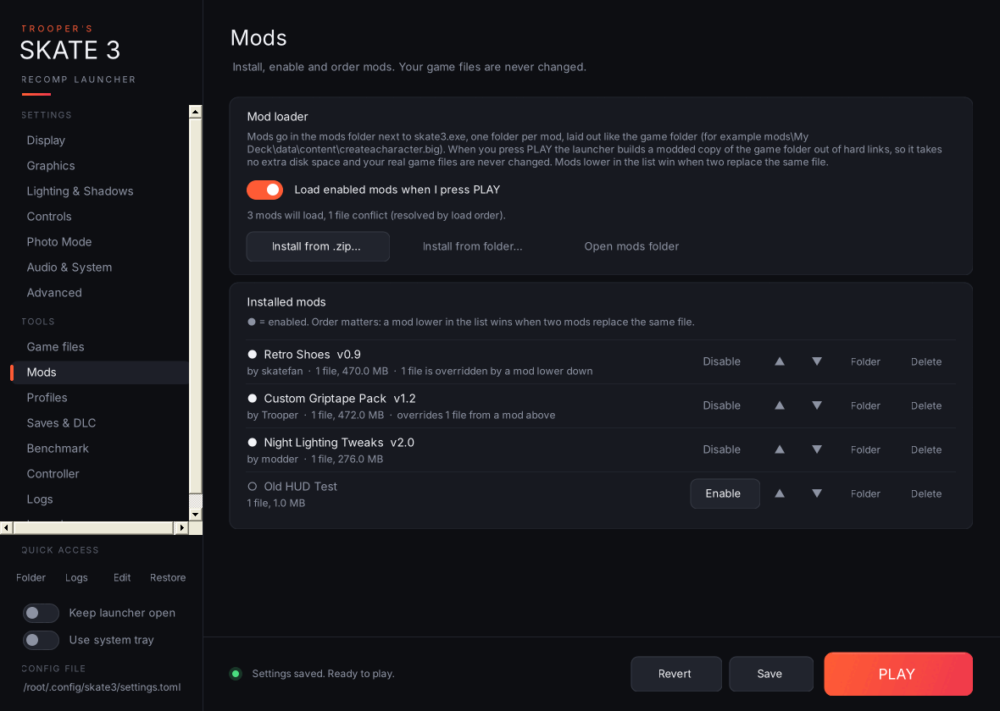
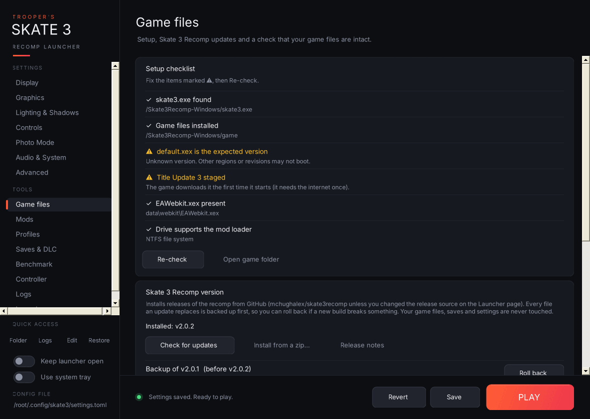
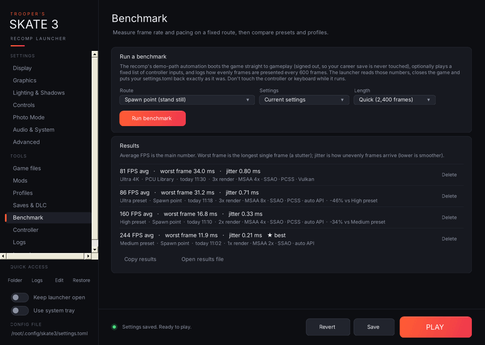

## Trooper's Skate 3 Recomp Launcher v3.1.0: mods, updates and benchmarks

**The biggest update yet.** v3.0.0 made the [Skate 3 Recomp](https://github.com/mchughalex/skate3recomp) easy to configure. v3.1.0 makes it easy to **install, keep working, mod and benchmark**. Everything from v3.0.0 is still here, your settings and profiles carry over, and it's still one portable `.exe`.

### Highlights

#### 🧩 Mod loader (new Mods page)
- Install mods from a `.zip` or a folder, turn them on and off, and move them up and down the load order.
- When you press PLAY the launcher builds a modded copy of the game folder out of **hard links**: no extra disk space, and your real `game` folder is never changed. With no mods enabled, the game starts exactly as before.
- Conflicts between mods are shown on each row, and you're warned once if a game file a mod replaces changes after an update.
- Making a mod is just a folder laid out like the game folder, plus an optional `mod.json`. See the [README](https://github.com/Trooper-code/Troopers-Skate-3-Recomp-Launcher#mods-page).

#### ⬇️ Recomp updates with rollback (new Game files page)
- **Install** downloads the latest `Skate3Recomp-Windows.zip` from GitHub and installs it over your current build.
- Every file it replaces is backed up first, a failed install undoes itself, and **Roll back** puts the previous build back in one click.
- The **update available** badge in the sidebar now takes you straight there.

#### ✅ Setup checklist and game file check
- Checks `skate3.exe`, the game files, the expected `default.xex`, **Title Update 3** (against the same hashes the recomp itself uses) and an NTFS drive for mods.
- Runs quietly at startup and opens the Game files page only if something's missing.
- **Full check** hashes every game file against a known-good dump. Got a different region? **Save as my baseline** once and later checks compare against your own files.

#### 📊 Benchmark (new page)
- Uses the recomp's own demo-path automation to boot straight to gameplay. It boots **signed out**, so your career save is never touched.
- Reads the frame-pacing data the recomp logs, closes the game, and puts `settings.toml` back exactly as it was (even if the launcher is closed halfway).
- Compare your current settings or any profile on the same route: **average FPS**, **worst frame** and **jitter**, with the change against your previous run.

#### 📸 Photo Mode (new settings page)
- Free-camera speed and look speed, and whether the skater freezes while you fly.
- The free-camera, screenshot, renderer-toggle and settings-menu keys, with a **press-a-key rebinder** and warnings when a key clashes with another bind or one of the recomp's own keys.
- See how many screenshots you've taken and open the folder or the latest one.

### Also new
- 🎮 **Controller navigation:** drive the launcher with an Xbox controller. D-pad to move, A to select, LB/RB to switch pages, Start to play, Back to save.
- 🚂 **Add to Steam:** adds the game as a non-Steam shortcut for Big Picture and Steam Deck, opening either the launcher or the game, with your own artwork if you want it.
- 🩺 **Graphics driver check:** shows your driver version and date, flags drivers over a year old, and checks a [known-issues list](https://github.com/Trooper-code/Troopers-Skate-3-Recomp-Launcher/blob/main/known-driver-issues.txt) kept in this repo.
- 🐞 **Better crash reports:** **Report on GitHub…** opens a pre-filled issue in the right project (the game or the launcher) with the full report on your clipboard. Optional Windows crash dumps go into the bug-report zip, and the report now includes your driver, mods and game-file status.
- ✨ **What's new** pop-up after you update the launcher, and the sidebar shrinks its entries so all 15 pages fit.

### Upgrading from v3.0.0
Replace the old exe with the new one. Your settings, profiles, history, save backups and launcher options are all kept. The first launch shows what's new.

### Install
1. Download `TroopersSkate3Launcher-v3.1.0-win.zip` below.
2. Extract `Trooper's Skate 3 Recomp Launcher.exe` into your Skate 3 Recomp folder, next to `skate3.exe`.
3. Run it. It needs Windows 10 or 11, which already includes the .NET Framework it uses.

The exe isn't code-signed, so Windows SmartScreen may warn you the first time. Click **More info → Run anyway**. This release was built by GitHub Actions directly from the source in this repo.

### Good to know
- Mods need the Skate 3 Recomp folder to be on an **NTFS** drive (most internal drives are), and must be Xbox 360 files. PS3 mods use different formats.
- Mods that change individual files *inside* the game's `.big` archives (most texture packs) aren't supported yet. That's next on the [Roadmap](https://github.com/Trooper-code/Troopers-Skate-3-Recomp-Launcher#roadmap).
- Found a bug? Use **Logs → Report on GitHub…** and it fills most of the issue in for you.

*Unofficial and not affiliated with the Skate 3 Recomp developers or EA. No game files are included. Screenshots show example mods and benchmark results.*
