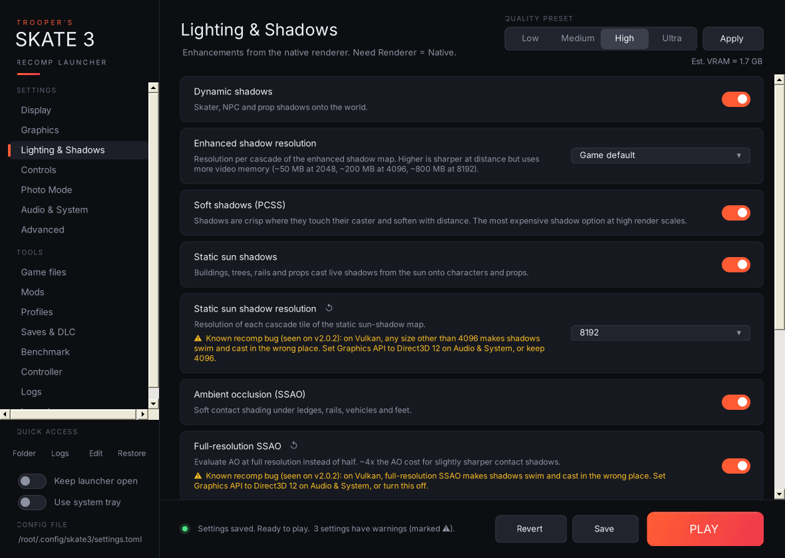

## Trooper's Skate 3 Recomp Launcher v3.1.1

A patch release with fixes and polish from play-testing v3.1.0. No new pages; everything from [v3.1.0](https://github.com/Trooper-code/Troopers-Skate-3-Recomp-Launcher/releases/tag/v3.1.0) is unchanged.

### ⚠ New: known-issue warnings

Settings that trigger a **known Skate 3 Recomp bug** now get a ⚠ warning on their card, with the workaround.

- **First rule:** on **Vulkan**, turning on **Full-resolution SSAO** or setting **Static sun shadow resolution** to anything other than 4096 makes shadows swim and cast in the wrong place (seen on recomp v2.0.2). Direct3D 12 doesn't have the problem, so the warning points you to **Audio & System → Graphics API → Direct3D 12**. The **Graphics API** card is flagged too.
- The rules live in [`known-issues.txt`](https://github.com/Trooper-code/Troopers-Skate-3-Recomp-Launcher/blob/main/known-issues.txt) in this repo. The launcher downloads the latest list at most every 12 hours, so new recomp bugs can be flagged, and fixed ones retired, **without a launcher update**. A copy is built in for offline use.

### 🐛 Fixed: portable installs

The recomp can keep its data next to `skate3.exe` instead of `%APPDATA%\skate3`, and v3.1.0 didn't know about it. On those installs it edited a `settings.toml` the game ignored and backed up the wrong saves. The launcher now follows the same rules as the recomp:

- **`portable.txt` next to `skate3.exe`:** settings, cache and DLC, plus the launcher's profiles, settings history, save backups and benchmark results, all use the game folder.
- **A `saves` folder next to `skate3.exe`:** save backups and restores use `saves\<profile id>\`.
- **Backups remember their layout.** The portable and normal save folders are stored differently, so a backup made from one is refused in the other instead of making a mess.
- **The Launcher page shows which folders are in use**, and pointing the launcher at a game with a different setup restarts it so it loads the right files.

`launcher.ini` always stays in `%APPDATA%\skate3`, so the launcher can always find your game.

### ✨ Polish

- **Status messages stay on screen.** "Saved profile", "Installed v2.0.3", "Bug report copied" and similar now stay up for about six seconds instead of being replaced within a second and a half. A new edit still replaces them straight away.
- **Disabled buttons look disabled.** For example, ▲ on the first mod and ▼ on the last one are greyed out instead of looking clickable.
- **Benchmarks aren't reported as crashes.** After a benchmark, the Logs page says "Last session was a benchmark run" instead of "didn't shut down cleanly", and bug reports say the same.
- **What's new** shows this release's changes once after updating, plus v3.1.0's if you're coming straight from v3.0.

### Install

1. Download `TroopersSkate3Launcher-v3.1.1-win.zip` below.
2. Extract `Trooper's Skate 3 Recomp Launcher.exe` into your Skate 3 Recomp folder, next to `skate3.exe` (replace the old one).
3. Run it. It needs Windows 10 or 11, which already includes the .NET Framework it uses.

Your settings, profiles, history, save backups and launcher options are all kept.

The exe isn't code-signed, so Windows SmartScreen may warn you the first time. Click **More info → Run anyway**. This release was built by GitHub Actions directly from the source in this repo.

*Unofficial and not affiliated with the Skate 3 Recomp developers or EA. No game files are included.*
