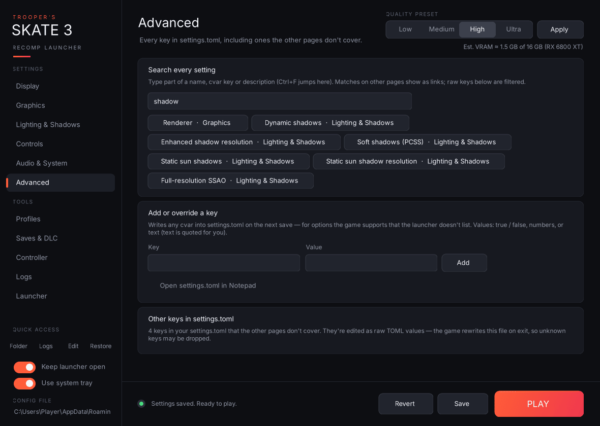

- **Search every setting:** type part of a name, cvar key or description (Ctrl+F jumps here). Matching settings on other pages appear as buttons; clicking one opens that page, scrolls to the card and highlights it. The raw keys further down are filtered as you type too.
- **Add or override a key:** writes any cvar into `settings.toml` on the next save, for options the game supports that the launcher doesn't list. Text values are quoted for you; `true`/`false`, numbers, quoted strings, arrays and tables are written as typed. Queued keys are listed until you save, and **Clear queued** forgets them. If the key already has a card somewhere, the launcher takes you to that card instead.
- **Open settings.toml in Notepad.**
- **Other keys in settings.toml:** one card for every key in your file that no other page covers. For your file today that's `skate3_draw_distance_stream_probe` and the three `vulkan_allow_present_mode_*` keys. True/false keys get a toggle; everything else gets a raw value box. Note that the game rewrites `settings.toml` when it exits, so keys it doesn't recognise may disappear.
