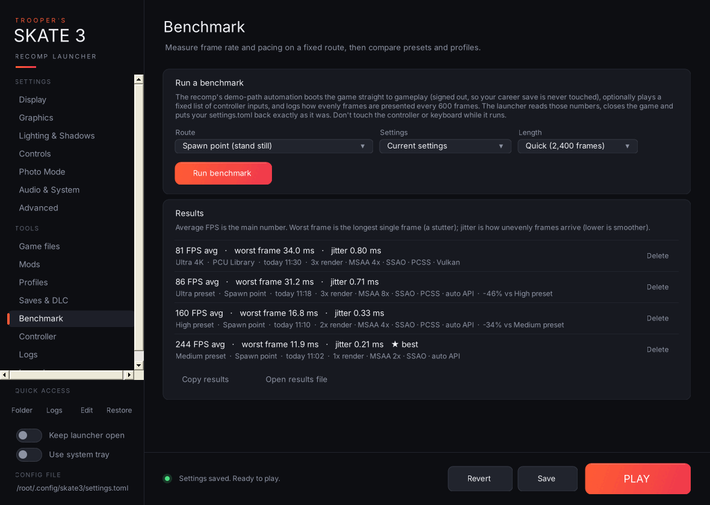

- **Run a benchmark:** pick a **Route**, the **Settings** to test (your current settings or any saved profile) and a **Length** (2,400 / 6,000 / 12,000 frames), then **Run benchmark**.
  - **Spawn point (stand still)** measures the spot where gameplay starts.
  - **PCU Library** uses the map-switch route from the recomp's own demo-path help text.
  - **Custom inputs** takes your own comma-separated list (`a b x y start back lb rb lt rt up down left right l3 r3`, with `:ms` to wait after one, for example `rt:1500`).
- **What happens:** the launcher saves your settings, adds the benchmark options to `settings.toml` (`skate3_demo_path`, `skate3_demo_path_gameplay_inputs`, `presenter_present_cadence_log` and a couple more), starts the game, and lets the recomp's demo-path automation boot straight to gameplay. That boot is **signed out**, so your career save is never touched. After the scene settles it reads the frame-pacing lines the recomp logs every 600 frames, closes the game, and puts `settings.toml` back exactly as it was. If the launcher is closed halfway, your settings are restored the next time it starts.
- **Results:** average FPS, worst frame (the longest single frame) and jitter (how unevenly frames arrive), with the settings, GPU and the change against the previous run on the same route. The best run is starred. **Copy results** and **Open results file** (`launcher-benchmarks.csv`).

Don't touch the keyboard or controller while it runs.
