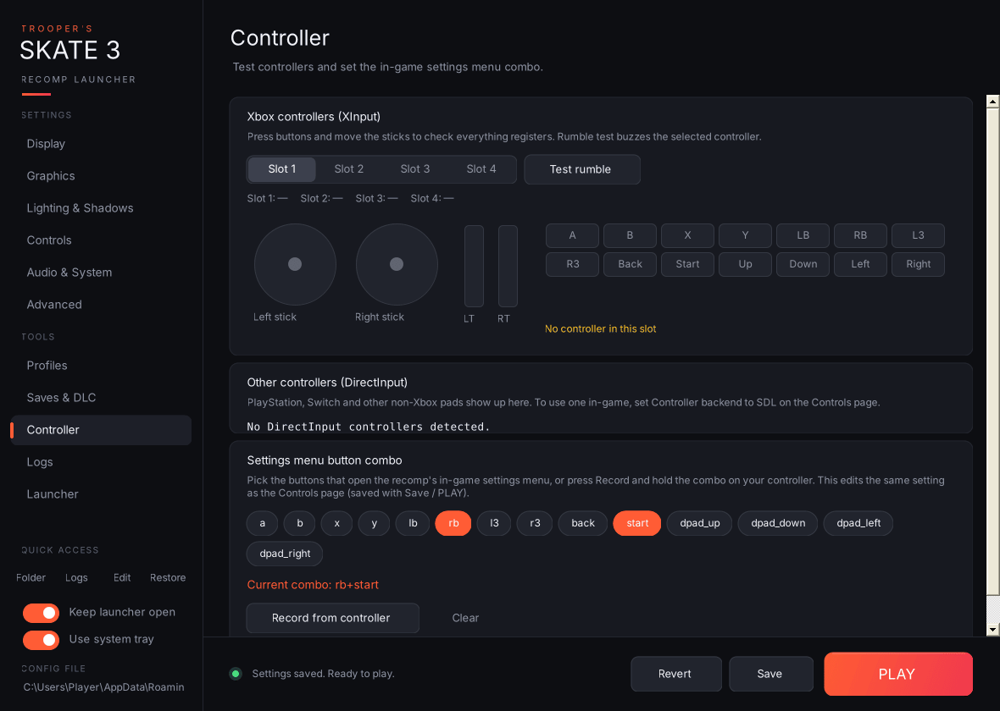

Live controller polling runs only while this page is open.

- **Xbox controllers (XInput):** pick **Slot 1–4** to see that controller's live state. Both sticks, both triggers and all 14 buttons light up as you press them. The line underneath shows which slots are connected. **Test rumble** buzzes the selected controller for about half a second.
- **Other controllers (DirectInput):** PlayStation, Switch and other HID pads, with live axes (X/Y/Z/R as percentages) and the numbers of any buttons being held. Xbox pads show up here too. To use a non-Xbox pad in-game, set **Controller backend** to SDL.
- **Settings menu button combo:** click button chips (a, b, x, y, lb, rb, l3, r3, back, start, dpad_up/down/left/right) to build the combo, or press **Record from controller** and hold the combo for about a second; recording gives up after 8 seconds. Chips glow green while that button is held on a connected Xbox pad. **Clear** disables the combo. This edits the same `menu_chord` setting as the Controls page, so it's saved with Save or PLAY.
