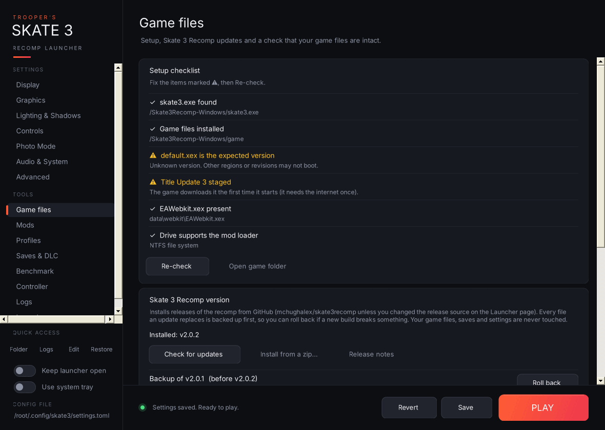

- **Setup checklist:** whether `skate3.exe` was found, the game files are installed, `default.xex` is the version the recomp is built for, **Title Update 3** is staged (checked against the same SHA-256 hashes the recomp's own installer uses), `EAWebkit.xex` is present, and the drive is NTFS (needed by the mod loader). If the game files aren't installed yet, **Start the game's installer** runs `skate3.exe` so you can pick your ISO. On startup the launcher runs this check quietly and opens this page if something's missing.
- **Skate 3 Recomp version:** your installed version and the latest release on GitHub.
  - **Install vX.Y.Z** downloads `Skate3Recomp-Windows.zip` and installs it over your current build. Every file it replaces is backed up into `recomp-backups` first, and if anything goes wrong mid-install the old build is put back automatically. Your `game` folder, saves, settings, mods and this launcher are never touched.
  - **Install from a zip…** installs a release zip you already downloaded.
  - **Roll back** (one row per backup, newest 3 kept) puts the previous build back.
- **Check game files:** **Quick check** compares file sizes; **Full check** hashes every file (about 6 GB) against a known-good NTSC-U dump. Other regions show differences here, so if your game runs fine, press **Save as my baseline** once and later checks compare against your own files.
