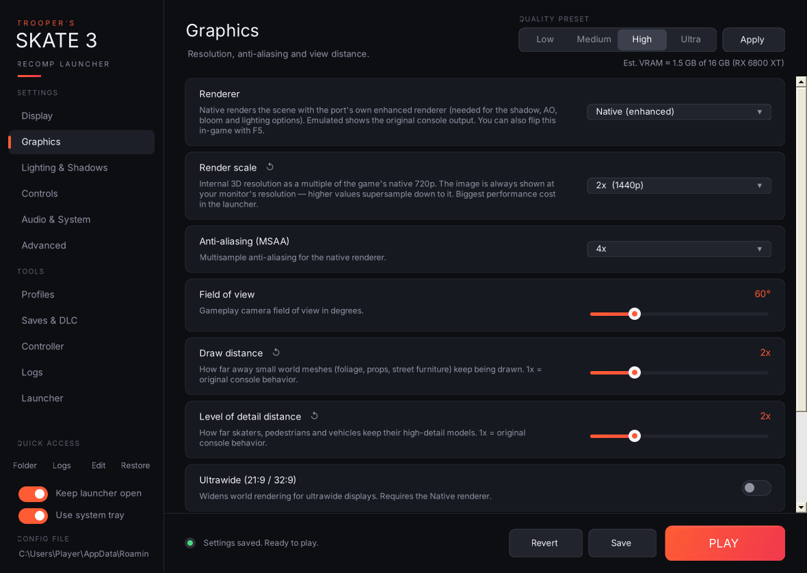

# Trooper's Skate 3 Recomp Launcher

**A portable launcher, settings editor, mod loader and toolbox for the [Skate 3 Recomp](https://github.com/mchughalex/skate3recomp) PC port.** One `.exe`, no installer, no extra DLLs. Drop it next to `skate3.exe` and press **PLAY**.

> **Unofficial.** Not affiliated with the Skate 3 Recomp developers or EA. The launcher contains **no game files or recomp files**: you need your own copy of the recomp.

**Latest version: [v3.1.1](https://github.com/Trooper-code/Troopers-Skate-3-Recomp-Launcher/releases/latest)** · [Download](https://github.com/Trooper-code/Troopers-Skate-3-Recomp-Launcher/releases) · [Report a bug](https://github.com/Trooper-code/Troopers-Skate-3-Recomp-Launcher/issues) · [[Release History]]

## Start here

- **New to the launcher?** [[Installation]] gets you running in two minutes.
- **Something wrong?** [[Troubleshooting]] and the [[FAQ]] cover the common problems. [[Warnings and Known Issues]] lists recomp bugs and their workarounds.
- **Want mods?** [[Mods]] shows how to install them. [[Making Mods]] shows how to make your own.

## What it does

| | |
|---|---|
| **Settings** | Every recomp option on clean pages with plain-English help, [quality presets and a live VRAM estimate](Presets-and-VRAM), and [warnings when settings clash](Warnings-and-Known-Issues). See [[Settings Pages]] and the [[Advanced Page]]. |
| **Install and update the recomp** | One-click updates from GitHub with rollback, a setup checklist and a full game-file check. See [[Game Files and Recomp Updates]]. |
| **Mods** | Install, enable and order mods without touching your game files. See [[Mods]] and [[Making Mods]]. |
| **Protect your career** | Saves are zipped every time you press PLAY. See [[Saves and DLC]]. |
| **Profiles** | Switch between setups like "Ultra 4K" and "Potato laptop" in one click, or from a desktop shortcut. See [[Profiles]]. |
| **Benchmark** | The game drives itself to the same spot every run, so you can compare settings with real numbers. See [[Benchmark]]. |
| **Photo Mode** | Free-camera speed and rebindable free-camera and screenshot keys. See [Settings Pages](Settings-Pages#photo-mode). |
| **Crash help** | Log viewer, crash check and one-click bug reports. See [[Logs and Bug Reports]]. |
| **Plus** | Add to Steam, graphics-driver check, controller navigation, controller tester, shader-cache cleaner, system tray, Discord Rich Presence and command-line quick play. See [[Launcher Page]], [[Controller]], [[System Tray and Discord]] and [[Command Line and Shortcuts]]. |

## How the wiki is organised

The sidebar follows the launcher's own sidebar: **Getting started**, then one page per **Settings** and **Tools** page, then **Reference** pages for the details. If you're looking for how something works behind the scenes, start with [[What Happens When You Press PLAY]] and [[Files the Launcher Creates]].
