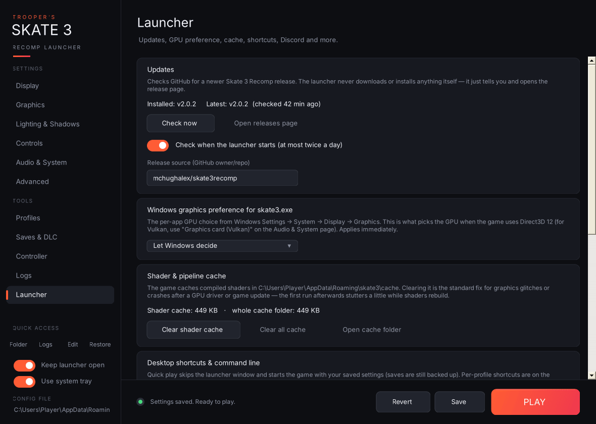

- **Updates:** shows your installed Skate 3 Recomp version (read from the game's log, or from `skate3.exe` itself) and the latest release on GitHub.
  - **Check now** and **Open releases page**.
  - **Check when the launcher starts:** on by default, and checks at most once every 12 hours.
  - **Release source:** the GitHub `owner/repo` to check. The default is `mchughalex/skate3recomp`; change it if you follow a fork.
  - Installing and rolling back updates is on the [Game files page](Game-Files-and-Recomp-Updates). The sidebar badge takes you there.
- **Windows graphics preference for skate3.exe:** Let Windows decide, Power saving or High performance. This is the same per-app setting as Windows Settings → System → Display → Graphics, and it's what decides the GPU under Direct3D 12. It applies immediately; it's stored in your user registry, so no admin rights are needed.
- **Add to Steam:** adds **Skate 3 (Recomp)** to your Steam library as a non-Steam game, so it works in Big Picture and on a Steam Deck. Choose whether it opens the launcher (controller-friendly) or plays straight away. Steam must be closed while the launcher edits its library file (a backup of `shortcuts.vdf` is kept). **Set artwork…** files your own images by shape: tall = library cover, very wide = hero banner, wide = grid, square = logo.
- **Graphics driver:** your GPU, driver version and date, and the Vulkan driver the game reported. Drivers over a year old are flagged, and **Check driver** also checks a list of known-bad versions kept in this repo (`known-driver-issues.txt`). **Get the latest driver** opens AMD's, NVIDIA's or Intel's driver page.
- **Controller navigation:** see [Keyboard and controller shortcuts](Command-Line-and-Shortcuts#keyboard-and-controller-shortcuts). **What's new** shows this version's changes again. The pop-up also appears once after each update (and includes v3.1.0's changes if you skipped it).
- **Shader & pipeline cache:** shows the size of the shader cache and of the whole `cache` folder.
  - **Clear shader cache** deletes `cache\nrhi_shaders` and `cache\shaders`.
  - **Clear all cache** deletes everything in `cache`.
  - **Open cache folder.**
  - Both clear buttons are refused while the game is running. The cache rebuilds itself, with a little stutter on the first run. Clearing it is the usual fix after a GPU driver or game update.
- **Desktop shortcuts & command line:**
  - **Launcher shortcut** opens the launcher.
  - **Quick-play shortcut** starts the game straight away with your saved settings, skipping the window; saves are still backed up.
  - The available [command-line options](Command-Line-and-Shortcuts) are listed here too.
- **Discord Rich Presence:** see [below](System-Tray-and-Discord#discord-rich-presence).
- **Modding tools:** **Show modding tools** (`modding_tools` in `launcher.ini`, off by default) adds a **Modding tools** page to the sidebar on the next launch for making and testing mods.
- **Game location & reset:**
  - Shows the game path, the settings folder and the saves folder (marked when portable mode or a portable `saves` folder is in use), the launcher version and the game version.
  - **Change game location…** points the launcher at a different `skate3.exe`. If that copy keeps its data somewhere else (portable mode), the launcher restarts to load it.
  - **Reset all settings to defaults** puts every setting back to its default on screen; Revert undoes it, and nothing is written until Save.
