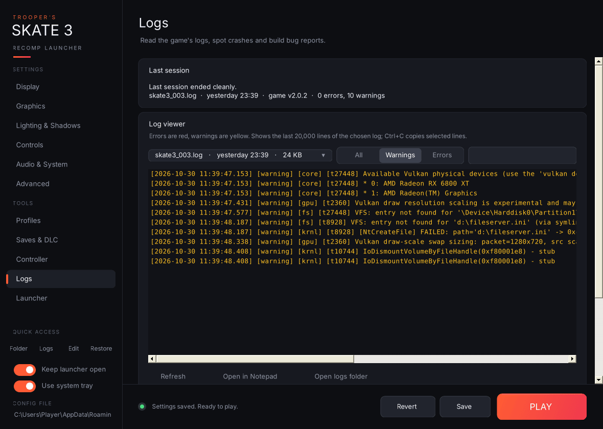

- **Last session:** reads the newest log in the game's `logs` folder and tells you whether the game is running, whether the last session **ended cleanly**, or whether the log **stops without the normal shutdown lines** (usually a crash or forced close). A session the launcher closed itself at the end of a benchmark is labelled as a benchmark run instead. It also shows the file, when it was written, the game version and the error/warning counts.
- **Log viewer:**
  - **Log file** dropdown: every `.log` file, newest first, with its age and size.
  - **All / Warnings / Errors** filter, plus a search box.
  - A colour-coded viewer (errors red, warnings yellow) showing the last 20,000 lines. Select lines and press **Ctrl+C** to copy them.
  - **Refresh**, **Open in Notepad**, **Open logs folder**.
- **Bug reports & cleanup:**
  - **Copy bug report:** puts a ready-to-paste report on the clipboard. It contains the launcher and game versions, Windows version, CPU, RAM, GPU list, monitors, the last session's status, your full `settings.toml`, the last 60 warnings/errors and the last 25 lines of the newest log.
  - **Save bug report (.zip):** writes `Skate3-bug-report-<date>.zip` to your desktop (`report.txt` + `settings.toml` + the newest two logs) and highlights it in Explorer.
  - **Delete old logs:** keeps the newest 3 logs and deletes the rest after telling you how much space that frees. The current log-folder size is shown underneath.

- **Report a crash:**
  - **Report on GitHub…** asks whether the problem is with the game or the launcher, then opens a new GitHub issue in the right project, pre-filled with your versions, PC, GPU driver, enabled mods, game-file status and the last session's status. The full bug report is copied to your clipboard to paste in.
  - **Keep crash dumps** asks Windows (one admin prompt) to save a small `.dmp` file whenever `skate3.exe` crashes. The newest dump from the last two weeks is added to the bug report zip.
  - **Open crash dumps folder** (`%LOCALAPPDATA%\CrashDumps`).

The bug report also lists your GPU driver, enabled mods, game-file check result and crash-dump status.

**Crash detection:** if the launcher is still running when the game exits with an error code (because Keep launcher open, the tray or Discord presence is on), it pops up the exit code, how long the game ran, and the last few warning/error lines from the log, then offers to open the Logs page.
