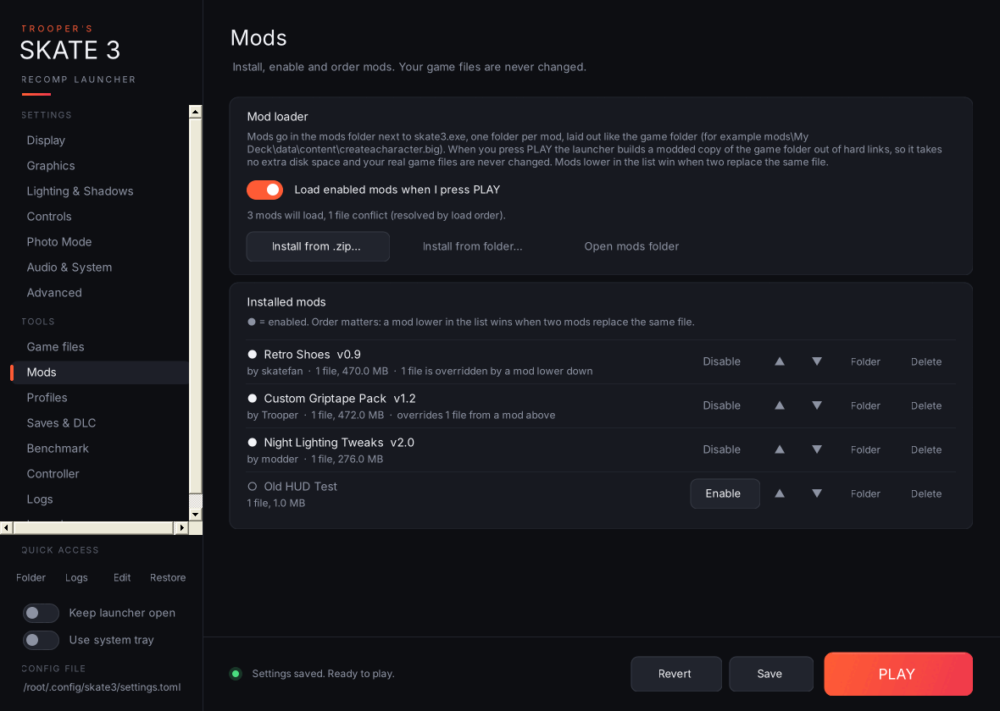

- **Load enabled mods when I press PLAY:** the master switch.
- Dropping the `mods` folder itself, the `game` folder or the recomp folder is refused, so you can't copy the game by accident.
- **Install from .zip… / Install from folder…** copies a mod into the `mods` folder next to `skate3.exe` and enables it. You can also **drag and drop** `.zip` files and mod folders straight onto the Mods page. **Open mods folder** opens it; you can also drop mod folders in by hand (new folders start disabled).
- **Installed mods:** one row per mod with its file count and size, and whether it overrides (or is overridden by) another mod. Buttons: **Enable / Disable**, ▲ / ▼ to change the load order, open its folder, and remove it. **Mods lower in the list win** when two mods replace the same file.

**How it works:** when you press PLAY with mods enabled, the launcher builds `mods\.active-game`, a copy of your `game` folder made of hard links (so it takes no extra space), swaps in the mods' files, and starts the game with `--game_data_root` pointing at it. Your real `game` folder is never changed, and it's only rebuilt when something changes. With no mods enabled the game starts normally. Mods can't replace `default.xex`, `default.xexp` or the EAWebkit files, because the recomp's code is built against exactly those.

If a game file a mod replaces changes later (for example after a game or recomp update), you're warned once before launching.

## Making your own mods

See **[[Making Mods]]** for the folder layout, `mod.json`, and the **Modding tools** page.
