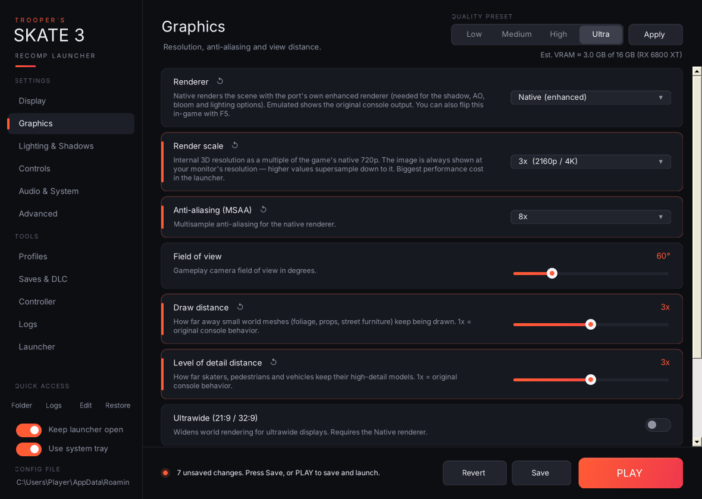

**Low / Medium / High / Ultra** plus **Apply** set render scale, MSAA, draw and LOD distance, every shadow option, SSAO, sun shafts, haze, packed HDR, and turn on the Native renderer, dynamic shadows and bloom. Applying a preset only changes what's on screen; nothing is saved until you press Save or PLAY.

| Preset | Render scale | MSAA | Draw / LOD | Shadow tile | PCSS | Static shadows | SSAO |
|---|---|---|---|---|---|---|---|
| Low | 1x | Off | 1.0x | Game default | Off | Off | Off |
| Medium | 1x | 2x | 1.5x | 2048 | Off | 2048 | Half-res |
| High | 2x | 4x | 2.0x | 2048 | On | 4096 | Half-res |
| Ultra | 3x | 8x | 3.0x | 4096 | On | 8192 | Full-res |

**Est. VRAM** under the preset picker updates live as you change settings. It's a rough model of game assets plus render targets (scaled by render scale, MSAA and HDR format) plus shadow maps, and it's compared against the VRAM of the GPU the game will use. It turns yellow above 90% of that card's memory. Treat it as a guide, not a measurement.
