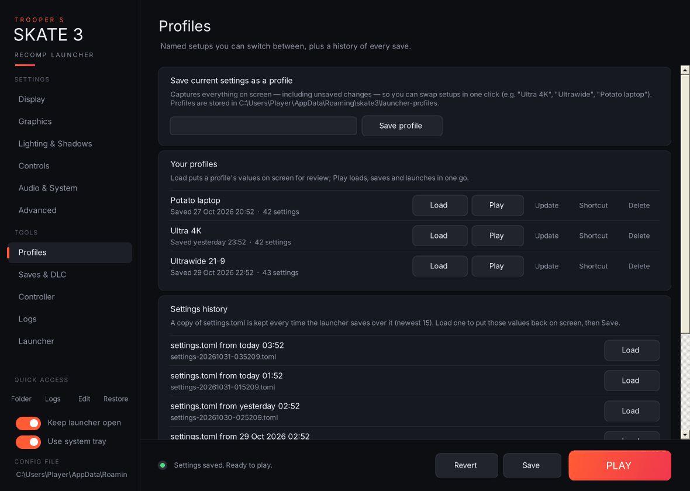

- **Save current settings as a profile:** give it a name such as "Ultra 4K" or "Ultrawide" and press **Save profile** (or Enter). This captures everything on screen, *including unsaved changes*, plus every other key in your file.
- **Your profiles:** one row per profile, with these buttons:
  - **Load:** puts the profile's values on screen, unsaved, so you can review them before saving.
  - **Play:** loads, saves and launches the game in one click.
  - 💾 **Update:** overwrites the profile with what's on screen now.
  - 🔗 **Shortcut:** creates a desktop shortcut `Skate 3 - <name>` that launches straight into the game with that profile (`--profile "<name>" --play`).
  - 🗑 **Delete.**
- **Settings history:** every time the launcher is about to overwrite `settings.toml` (Save, PLAY, restoring the original backup, or a profile shortcut), it first copies the current file into the history folder. The newest 15 are kept. **Load** puts any of them back on screen; Save makes it permanent. This is your "revert to last session" button.
- **Original backup:** **Restore original backup** replaces `settings.toml` with `settings.toml.launcher-backup`, the copy taken the very first time the launcher saved. This happens immediately, and the current file goes into history first.
