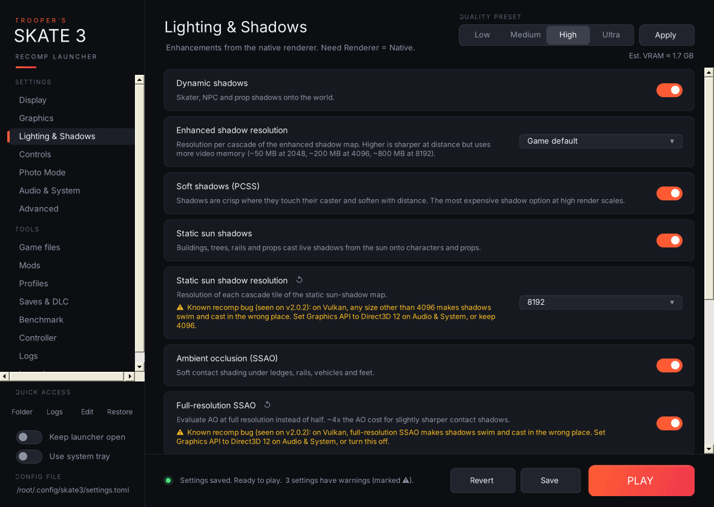
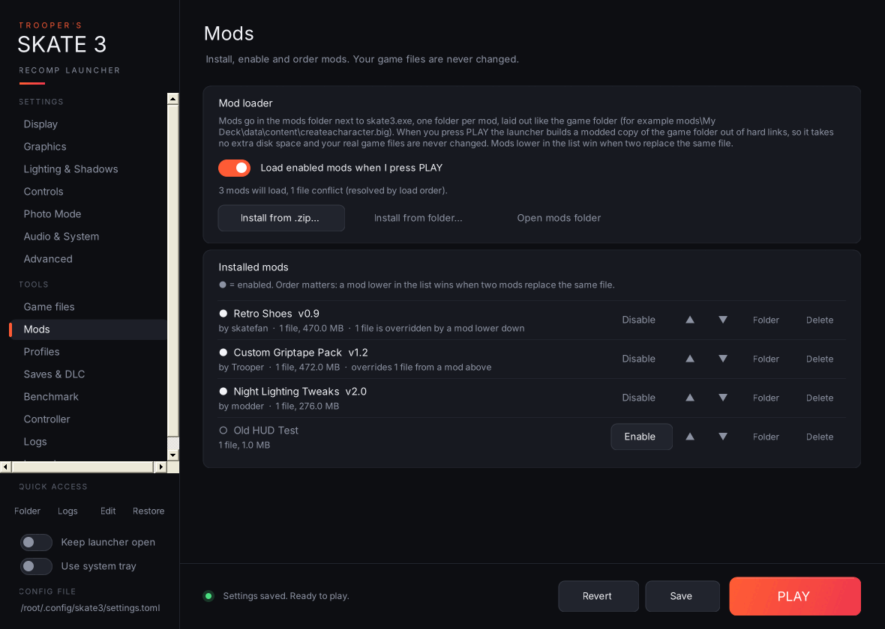
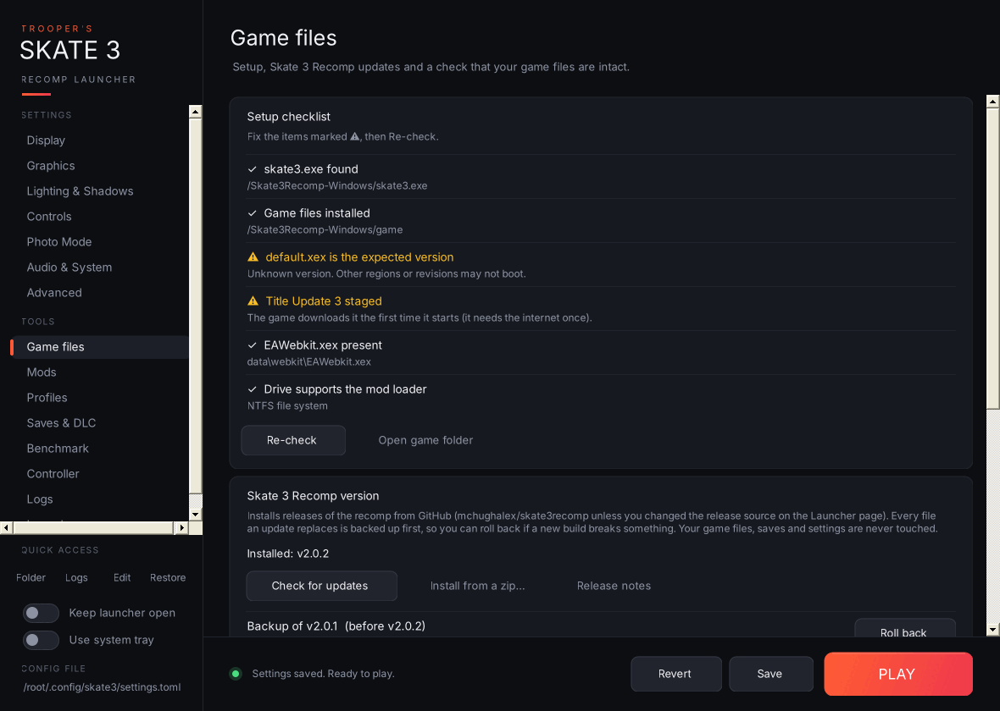
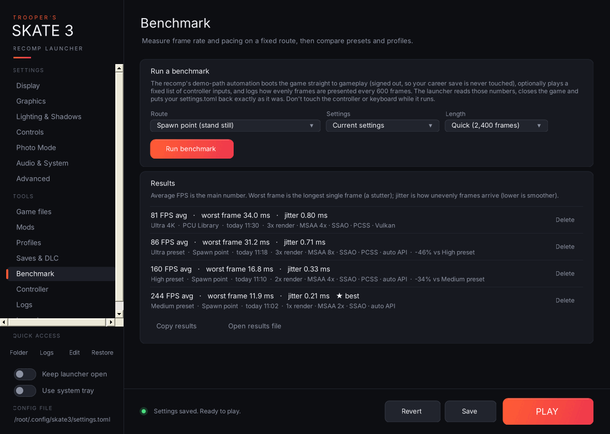
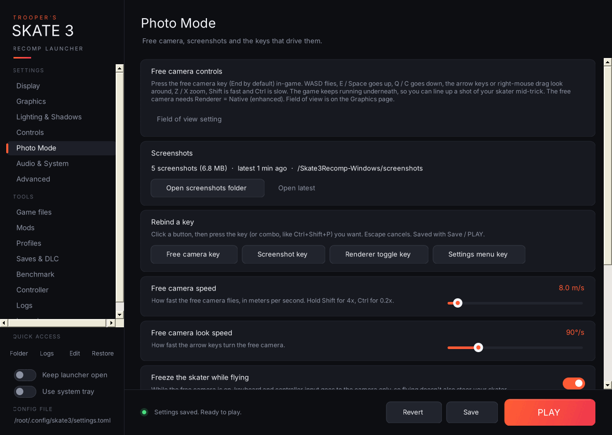
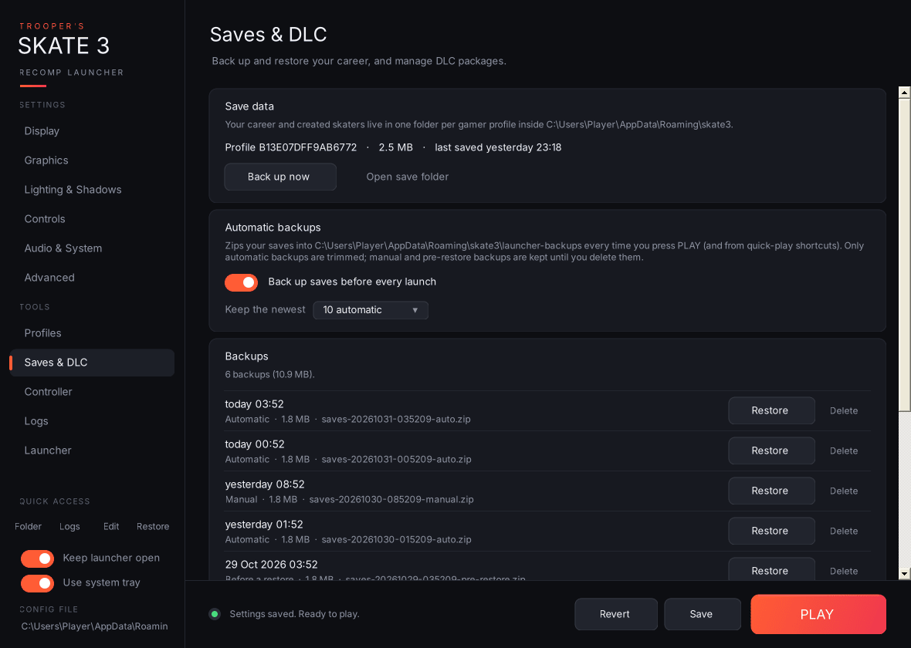

<div align="center">

# Trooper's Skate 3 Recomp Launcher

**A portable launcher, settings editor and toolbox for the [Skate 3 Recomp](https://github.com/mchughalex/skate3recomp) PC port.**

[](https://github.com/Trooper-code/Troopers-Skate-3-Recomp-Launcher/actions/workflows/build.yml)
[](https://github.com/Trooper-code/Troopers-Skate-3-Recomp-Launcher/releases)
[](LICENSE)


</div>

> **Unofficial.** Not affiliated with the Skate 3 Recomp developers or EA. This repo contains **NO GAME FILES OR RECOMPILATION FILES**: you need **YOUR OWN COPY** of the recomp.

## What's new in v3.1.1

A patch release from play-testing v3.1.0. [Release notes →](https://github.com/Trooper-code/Troopers-Skate-3-Recomp-Launcher/releases/tag/v3.1.1)



- **⚠ Known-issue warnings:** settings that trigger a known Skate 3 Recomp bug get a warning on their card, with the workaround. The first one: on Vulkan, full-resolution SSAO or a static sun shadow resolution other than 4096 breaks shadows, so the launcher points you to Direct3D 12. The list lives in [`known-issues.txt`](known-issues.txt) and updates without a new launcher release. See [Known issues](#known-issues).
- **🐛 Portable installs fixed:** with `portable.txt` or a `saves` folder next to `skate3.exe`, the launcher now edits the same `settings.toml` and backs up the same saves the game uses. See [Portable installs](#portable-installs).
- **✨ Polish:** status messages stay on screen for a few seconds, buttons you can't use look greyed out, and a finished benchmark is no longer reported as a crash.

## What's new in v3.1.0

**The biggest update yet.** The launcher now installs, checks, mods and benchmarks the recomp, not just configures it. [Full release notes →](https://github.com/Trooper-code/Troopers-Skate-3-Recomp-Launcher/releases/tag/v3.1.0)

| | |
|:-:|:-:|
| <br>**Mod loader:** install, enable and order mods. Hard links mean zero extra disk space, and your game files are never touched. | <br>**Game files:** a setup checklist, one-click recomp updates with rollback, and a full game-file check. |
| <br>**Benchmark:** the game drives itself to the same spot every run, so you can compare presets with real FPS, worst-frame and jitter numbers. | <br>**Photo Mode:** free-camera speed, rebindable free-camera and screenshot keys, and your screenshots one click away. |

**Also new:** 🎮 controller navigation for the launcher itself · 🚂 Add to Steam for Big Picture and Steam Deck · 🩺 graphics driver check · 🐞 pre-filled GitHub crash reports with optional crash dumps · ✨ a What's new pop-up after each update.

<sub>Screenshots show example mods and benchmark results.</sub>

## Why use it?

- **No more hand-editing!! `settings.toml`.** Every option on clean pages with plain-English help, quality presets and a live VRAM estimate. Only the keys you change are rewritten.
- **Catches mistakes before you launch.** Settings that clash (V-Sync + G-Sync, shadow options with the emulated renderer, a typo in the menu combo…) are flagged right on the card.
- **Picks the right GPU.** Lists your Vulkan GPUs with their VRAM, so the game never starts on the CPU's integrated graphics.
- **Protects your career.** Saves are zipped automatically every time you press PLAY, and restores always back up first.
- **Profiles.** Swap between "Ultra 4K", "Ultrawide" and "Potato laptop" in one click, or from a desktop shortcut.
- **Crash help.** A log viewer that highlights errors, tells you if the last session crashed, and builds a bug report in one click.
- **Mods without touching your game files.** Install, enable and order mods; the launcher builds a modded copy of the game folder out of hard links, so it takes no extra space.
- **Installs and updates the recomp.** One click downloads the latest Skate 3 Recomp build from GitHub, with a backup so you can roll back.
- **Spots a broken install before you launch.** First-run setup checklist, Title Update 3 check and a full game-file hash check.
- **Real benchmark numbers.** The game drives itself to the same spot every time while the launcher records frame times, so you can compare presets and profiles.
- **Plus:** Photo Mode page (free camera and screenshot keys), Add to Steam, graphics-driver check, pre-filled GitHub crash reports, controller navigation, controller tester, menu-combo recorder, shader-cache cleaner, system tray, Discord Rich Presence and command-line quick play.
- **One portable `.exe`.** No installer, no extra DLLs. It runs on the .NET Framework every Windows 10/11 PC already has.
## Download

1. Grab `TroopersSkate3Launcher-vX.Y.Z-win.zip` from [**Releases**](https://github.com/Trooper-code/Troopers-Skate-3-Recomp-Launcher/releases).
2. Extract `Trooper's Skate 3 Recomp Launcher.exe` into your Skate 3 Recomp folder, next to `skate3.exe`.
3. Run it.

v3.1.0 adds a **mod loader**, **recomp updates with rollback**, **game-file checks**, a **benchmark** and more. See the [release notes](https://github.com/Trooper-code/Troopers-Skate-3-Recomp-Launcher/releases) and the [Roadmap](#roadmap) for what's coming.

**Windows SmartScreen:** the exe isn't code-signed, so the first launch may show "Windows protected your PC". Click **More info → Run anyway**. Every release is built by GitHub Actions straight from this source.

## Roadmap

- [x] **Mod loader:** install, enable, disable and order mods from inside the launcher (v3.1.0).
- [ ] **Texture pack support:** add, switch between and manage custom texture packs, including mods that change individual files inside the game's archives.

**MUTLIPLAYER NOT PLANNED**
-I WILL NOT BE IMPLEMENTING NETWORKING CAPABILITIES. THIS IS BEYOND MY SCOPE OF UNDERSTANDING, AND THEREFORE IS **NOT** PLANNED. HOWEVER IS SOMEONE DOES IT BEFORE ME I WILL MORE THAN LIKELY FIGURE OUT HOW TO INTEGRATE SUPPORT FOR THEIR TOOL INTO MY LAUNCHER.

Suggestions and bug reports are welcome in [Issues](https://github.com/Trooper-code/Troopers-Skate-3-Recomp-Launcher/issues).

## Known issues

These are bugs in the Skate 3 Recomp itself, not in the launcher. They're listed here so you don't lose time on them, and removed once the recomp fixes them.

Since v3.1.1 the launcher also **warns you on the setting's card** (⚠) when your settings would trigger one of these. The rules live in [`known-issues.txt`](known-issues.txt) in this repo, and the launcher downloads the latest list at most every 12 hours, so new warnings don't need a launcher update.

| Issue | Workaround |
|---|---|
| **Shadows swim, jump around or cast in the wrong place on Vulkan** when **Full-resolution SSAO** is on or **Static sun shadow resolution** is changed from 4096. Seen with recomp v2.0.2 on an AMD Radeon RX 6800 XT. | Set **Audio & System → Graphics API** to **Direct3D 12** (fixes it), or keep those two settings at their defaults (Full-resolution SSAO off, Static sun shadow resolution 4096) when using Vulkan. |

Found another one? Use **Logs → Report on GitHub…** and pick "The game (Skate 3 Recomp)".

## Screenshots

| | |
|:-:|:-:|
| <br>**Conflict warnings** flag settings that fight each other | <br>**Quality presets** with a live VRAM estimate and unsaved-change markers |
| <br>**Lighting & Shadows**: every native-renderer enhancement | <br>**GPU picker** and per-setting reset buttons |
| <br>**Advanced**: search every setting, edit any raw cvar | <br>**Profiles**, settings history and one-click shortcuts |
| <br>**Save backups** and one-click restore, plus DLC | <br>**Controller tester** and menu-combo recorder |
| <br>**Logs**: crash check, filtered viewer, bug reports | <br>**Launcher tools**: updates, GPU preference, cache, Discord |

<sub>The screenshots were captured on a test machine without the Windows icon fonts, so buttons show text where Windows shows icons.</sub>

---

# Full guide

## Contents

1. [Quick start](#quick-start)
2. [The window at a glance](#the-window-at-a-glance)
3. [Settings pages](#settings-pages)
4. [Features on every settings card](#features-on-every-settings-card)
5. [Quality presets and VRAM estimate](#quality-presets-and-vram-estimate)
6. [Conflict warnings](#conflict-warnings)
7. [Advanced page](#advanced-page)
8. [Profiles page](#profiles-page)
9. [Game files page](#game-files-page)
10. [Mods page](#mods-page)
11. [Saves & DLC page](#saves--dlc-page)
12. [Benchmark page](#benchmark-page)
13. [Controller page](#controller-page)
14. [Logs page](#logs-page)
15. [Launcher page](#launcher-page)
16. [What happens when you press PLAY](#what-happens-when-you-press-play)
17. [System tray](#system-tray)
18. [Discord Rich Presence](#discord-rich-presence)
19. [Command line and shortcuts](#command-line-and-shortcuts)
20. [Keyboard and controller shortcuts](#keyboard-and-controller-shortcuts)
21. [Portable installs](#portable-installs)
22. [Files the launcher creates](#files-the-launcher-creates)
23. [Building from source](#building-from-source)
24. [Troubleshooting](#troubleshooting)

---

## Quick start

1. Put `Trooper's Skate 3 Recomp Launcher.exe` in the same folder as `skate3.exe` (or in a subfolder of it). It finds the game automatically. If it can't, **PLAY** asks you to locate `skate3.exe` once and remembers it.
2. Change whatever you like. Cards with unsaved changes get an orange strip down their left edge.
3. Press **PLAY**. That saves your changes, backs up your saves and starts the game.

---

## The window at a glance

| Area | What it does |
|---|---|
| **Sidebar → Settings** | Display, Graphics, Lighting & Shadows, Controls, Photo Mode, Audio & System, Advanced. |
| **Sidebar → Tools** | Game files, Mods, Profiles, Saves & DLC, Benchmark, Controller, Logs, Launcher. |
| **Update badge** (under the logo) | Appears only when a newer Skate 3 Recomp release is out. Click it to install it from the Game files page. |
| **Quick access** (four icon buttons) | Open the settings folder · Open the game's `logs` folder · Open `settings.toml` in Notepad · **Restore backup** (puts `settings.toml` back to how it was before the launcher first changed it). Hover any button for its name. |
| **Keep launcher open** | Leaves the window open after PLAY instead of closing it. |
| **Use system tray** | Minimizing sends the launcher to the tray, and PLAY tucks it into the tray while you play (see [System tray](#system-tray)). |
| **Config file** | Shows the full path of the `settings.toml` being edited, with "Will be created on save" if it doesn't exist yet. |
| **Header** | Page title, the **Quality preset** picker with **Apply**, and the **estimated VRAM** readout. The preset and VRAM readout appear only on settings pages. |
| **Footer** | Status line, **Revert** (throws away unsaved changes and reloads the file), **Save** (Ctrl+S), and **PLAY**, which shows **RUNNING** while the game is open. |

The status line always tells you where things stand: unsaved change count, "Settings saved. Ready to play.", whether the game is running, or that `skate3.exe` couldn't be found. It also tells you how many settings have warnings. Messages about something you just did ("Saved profile", "Installed v2.0.3", "Bug report copied") stay up for about six seconds, until you change something else.

---

## Settings pages

Every option writes the cvar named in brackets to `%APPDATA%\skate3\settings.toml` (or to the `settings.toml` next to `skate3.exe` in [portable mode](#portable-installs)).

### Display
- **Fullscreen** (`fullscreen`): borderless fullscreen instead of a window.
- **Monitor** (`monitor`): which display the game opens on (Default, Monitor 1–4).
- **V-Sync** (`vsync`).
- **Variable refresh rate (G-Sync / FreeSync)** (`d3d12_allow_variable_refresh_rate_and_tearing`).
- **Frame limiter** (`d3d12_present_frame_limiter`) and **Frame limiter target** (`d3d12_present_frame_limiter_fps`, 30–360 FPS).
- **Automatic game FPS cap** (`skate3_guest_fps_cap_auto`) and **Manual game FPS cap** (`skate3_guest_fps_cap`, Off–360).
- **FPS counter** (`show_fps_counter`).

### Graphics
- **Renderer** (`skate3_native_render_scene`): Native (enhanced) or Emulated (original).
- **Render scale** (`resolution_scale`): 1x / 2x / 3x. This also writes `draw_resolution_scale_x` and `draw_resolution_scale_y`, so the three always match.
- **Anti-aliasing (MSAA)** (`skate3_native_render_scene_msaa`): Off / 2x / 4x / 8x.
- **Field of view** (`skate3_field_of_view`): 40–120°.
- **Draw distance** (`skate3_draw_distance_scale`) and **Level of detail distance** (`skate3_lod_distance_scale`): 1x–5x.
- **Ultrawide** (`skate3_ultrawide`) and **Ultrawide aspect** (`skate3_ultrawide_target_aspect`): Auto, 21:9 (2560×1080), 21:9 (3440×1440), 32:9.
- **Renderer indicator** (`skate3_native_render_mode_indicator`).

### Lighting & Shadows (Native renderer only)
Dynamic shadows, Enhanced shadow resolution, Soft shadows (PCSS), Static sun shadows and their resolution, Ambient occlusion (SSAO) and full-resolution SSAO, Bloom, Volumetric sun shafts, Directional haze, Screen-space reflections (experimental), and Packed HDR targets.

### Controls
- **Controller backend** (`input_backend`): XInput, or SDL for PlayStation, Switch and other pads.
- **Controller rumble** (`hid_rumble_enabled`).
- **Mouse & keyboard mode** (`mnk_mode`), **Capture mouse** (`mnk_capture_mouse`), **Mouse sensitivity** (`mnk_sensitivity`).
- **Settings menu button combo** (`menu_chord`): typed here, or picked and recorded on the [Controller page](#controller-page).
- **Skippable intro movies** (`skate3_intro_movie_skip`).

### Photo Mode


- **Free camera speed** (`skate3_native_render_scene_freecam_speed`, 0.5–100 m/s) and **Free camera look speed** (`skate3_native_render_scene_freecam_look_speed`, 10–360°/s).
- **Freeze the skater while flying** (`skate3_native_render_scene_freecam_capture_input`).
- **Free camera key** (`bind_skate3_freecam`, End), **Screenshot key** (`bind_skate3_screenshot`, F6), **Renderer toggle key** (`bind_skate3_native_render_toggle`, F5) and **Settings menu key (alternate)** (`bind_skate3_menu_alt`, F1).
- **Rebind a key:** click a button, then press the key or combo (for example Ctrl+Shift+P). Key names are written exactly the way the recomp spells them.
- **Free camera controls:** a summary of the in-game controls (WASD to fly, E/Space up, Q/C down, arrows or right-mouse drag to look, Z/X zoom, Shift fast, Ctrl slow). The free camera needs Renderer = Native.
- **Screenshots:** how many you've taken, **Open screenshots folder** (`screenshots` next to `skate3.exe`) and **Open latest**.

The quality-preset picker is hidden on this page because presets don't touch these options.

### Audio & System
- **Mute audio** (`audio_mute`) and **Audio buffer size** (`audio_device_sample_frames`).
- **Game language** (`user_language`): 12 languages.
- **Graphics API** (`gpu_backend`): Auto, Direct3D 12 or Vulkan.
- **Graphics card (Vulkan)** (`vulkan_device`): *new.* Picks which GPU the game uses with Vulkan. The list is read straight from your Vulkan driver, in the same order the game uses, and shows each card's VRAM and whether it is discrete or integrated. For example: `0: AMD Radeon RX 6800 XT (16 GB, discrete)` and `1: AMD Radeon(TM) Graphics (integrated)`. If the driver can't be queried, the list comes from the game's own log instead. "Automatic" leaves the choice to the game and writes nothing.

If `settings.toml` holds a value that isn't in a dropdown's list, the dropdown shows it as **Custom (value)** and leaves it alone.

---

## Features on every settings card

- **Unsaved marker:** an orange strip on the card's left edge until you save.
- **Reset to default** (↺ button next to the setting's name): appears only when the setting differs from its default. Hover it to see the default value; click it to set the setting back. Like any other change, this isn't written until you Save or press PLAY.
- **Warnings:** a yellow ⚠ line under the help text when the setting conflicts with another one, or would trigger a known recomp bug (see [Conflict warnings](#conflict-warnings) and [Known issues](#known-issues)).
- Scrolling the mouse wheel over a dropdown or slider scrolls the page, not the value, so you can't change something by accident.

---

## Quality presets and VRAM estimate


**Low / Medium / High / Ultra** plus **Apply** set render scale, MSAA, draw and LOD distance, every shadow option, SSAO, sun shafts, haze, packed HDR, and turn on the Native renderer, dynamic shadows and bloom. Applying a preset only changes what's on screen; nothing is saved until you press Save or PLAY.

| Preset | Render scale | MSAA | Draw / LOD | Shadow tile | PCSS | Static shadows | SSAO |
|---|---|---|---|---|---|---|---|
| Low | 1x | Off | 1.0x | Game default | Off | Off | Off |
| Medium | 1x | 2x | 1.5x | 2048 | Off | 2048 | Half-res |
| High | 2x | 4x | 2.0x | 2048 | On | 4096 | Half-res |
| Ultra | 3x | 8x | 3.0x | 4096 | On | 8192 | Full-res |

**Est. VRAM** under the preset picker updates live as you change settings. It's a rough model of game assets plus render targets (scaled by render scale, MSAA and HDR format) plus shadow maps, and it's compared against the VRAM of the GPU the game will use. It turns yellow above 90% of that card's memory. Treat it as a guide, not a measurement.

---

## Conflict warnings


The launcher checks your settings against each other and puts a ⚠ line on the affected card:

| Situation | Warning appears on |
|---|---|
| Renderer is **Emulated** | MSAA and every Lighting & Shadows option ("No effect while Renderer is set to Emulated"), and Ultrawide (which needs Native). |
| Dynamic shadows off | Enhanced shadow resolution, Soft shadows (PCSS). |
| Static sun shadows off | Static sun shadow resolution. |
| SSAO off | Full-resolution SSAO. |
| Ultrawide off but an aspect is chosen | Ultrawide aspect. |
| V-Sync on together with VRR | V-Sync (adds latency and judder). |
| Frame limiter off but its target was changed | Frame limiter target. |
| Automatic FPS cap on and a manual cap set | Manual game FPS cap (ignored). |
| Mouse & keyboard mode off | Capture mouse, Mouse sensitivity (if changed). |
| Menu combo uses an unknown button name, or is a single button | Settings menu button combo. |
| Monitor number higher than the number of connected monitors | Monitor. |
| A Vulkan GPU is chosen but Graphics API isn't Vulkan, the index doesn't exist, or it's the integrated GPU while a discrete one exists | Graphics card (Vulkan). |
| Estimated VRAM above 90% of the GPU's memory | Render scale. |
| A key bind is empty, isn't a key name the recomp knows, or is already used (by another bind or by the recomp's own F2–F4, F8–F12, Backtick or Escape) | That key bind on the Photo Mode page. |
| Renderer is **Emulated** | Free camera key and Free camera speed (the free camera needs Native). |
| A setting matches a rule in [`known-issues.txt`](known-issues.txt), for example Vulkan with Full-resolution SSAO on or a Static sun shadow resolution other than 4096 | That setting, and Graphics API. The warning names the recomp bug and the workaround. |

Warnings never block saving. They're there to tell you a setting won't do what you might expect.

---

## Advanced page


- **Search every setting:** type part of a name, cvar key or description (Ctrl+F jumps here). Matching settings on other pages appear as buttons; clicking one opens that page, scrolls to the card and highlights it. The raw keys further down are filtered as you type too.
- **Add or override a key:** writes any cvar into `settings.toml` on the next save, for options the game supports that the launcher doesn't list. Text values are quoted for you; `true`/`false`, numbers, quoted strings, arrays and tables are written as typed. Queued keys are listed until you save, and **Clear queued** forgets them. If the key already has a card somewhere, the launcher takes you to that card instead.
- **Open settings.toml in Notepad.**
- **Other keys in settings.toml:** one card for every key in your file that no other page covers. For your file today that's `skate3_draw_distance_stream_probe` and the three `vulkan_allow_present_mode_*` keys. True/false keys get a toggle; everything else gets a raw value box. Note that the game rewrites `settings.toml` when it exits, so keys it doesn't recognise may disappear.

---

## Profiles page


- **Save current settings as a profile:** give it a name such as "Ultra 4K" or "Ultrawide" and press **Save profile** (or Enter). This captures everything on screen, *including unsaved changes*, plus every other key in your file.
- **Your profiles:** one row per profile, with these buttons:
  - **Load:** puts the profile's values on screen, unsaved, so you can review them before saving.
  - **Play:** loads, saves and launches the game in one click.
  - 💾 **Update:** overwrites the profile with what's on screen now.
  - 🔗 **Shortcut:** creates a desktop shortcut `Skate 3 - <name>` that launches straight into the game with that profile (`--profile "<name>" --play`).
  - 🗑 **Delete.**
- **Settings history:** every time the launcher is about to overwrite `settings.toml` (Save, PLAY, restoring the original backup, or a profile shortcut), it first copies the current file into the history folder. The newest 15 are kept. **Load** puts any of them back on screen; Save makes it permanent. This is your "revert to last session" button.
- **Original backup:** **Restore original backup** replaces `settings.toml` with `settings.toml.launcher-backup`, the copy taken the very first time the launcher saved. This happens immediately, and the current file goes into history first.

---

## Game files page


- **Setup checklist:** whether `skate3.exe` was found, the game files are installed, `default.xex` is the version the recomp is built for, **Title Update 3** is staged (checked against the same SHA-256 hashes the recomp's own installer uses), `EAWebkit.xex` is present, and the drive is NTFS (needed by the mod loader). If the game files aren't installed yet, **Start the game's installer** runs `skate3.exe` so you can pick your ISO. On startup the launcher runs this check quietly and opens this page if something's missing.
- **Skate 3 Recomp version:** your installed version and the latest release on GitHub.
  - **Install vX.Y.Z** downloads `Skate3Recomp-Windows.zip` and installs it over your current build. Every file it replaces is backed up into `recomp-backups` first, and if anything goes wrong mid-install the old build is put back automatically. Your `game` folder, saves, settings, mods and this launcher are never touched.
  - **Install from a zip…** installs a release zip you already downloaded.
  - **Roll back** (one row per backup, newest 3 kept) puts the previous build back.
- **Check game files:** **Quick check** compares file sizes; **Full check** hashes every file (about 6 GB) against a known-good NTSC-U dump. Other regions show differences here, so if your game runs fine, press **Save as my baseline** once and later checks compare against your own files.

---

## Mods page


- **Load enabled mods when I press PLAY:** the master switch.
- **Install from .zip… / Install from folder…** copies a mod into the `mods` folder next to `skate3.exe` and enables it, or drag and drop `.zip` archives and mod folders straight onto the Mods page. **Open mods folder** opens it; you can also drop mod folders in by hand (new folders start disabled).
- **Installed mods:** one row per mod with its file count and size, and whether it overrides (or is overridden by) another mod. Buttons: **Enable / Disable**, ▲ / ▼ to change the load order, open its folder, and remove it. **Mods lower in the list win** when two mods replace the same file.

**How it works:** when you press PLAY with mods enabled, the launcher builds `mods\.active-game`, a copy of your `game` folder made of hard links (so it takes no extra space), swaps in the mods' files, and starts the game with `--game_data_root` pointing at it. Your real `game` folder is never changed, and it's only rebuilt when something changes. With no mods enabled the game starts normally. Mods can't replace `default.xex`, `default.xexp` or the EAWebkit files, because the recomp's code is built against exactly those.

If a game file a mod replaces changes later (for example after a game or recomp update), you're warned once before launching.

**Making a mod:** a folder laid out like the `game` folder, holding only the files you change:

```
mods\
  My Deck Pack\
    mod.json                         (optional)
    data\content\createacharacter.big
```

`mod.json` is optional and supports format 1 metadata: `name`, `author`, `version`, `description`, `preview` (a thumbnail image shown on the mod's row), `targets.recomp` (`"official"`, `"plus"` for Skate 3 Recompiled+, or `"any"`), `targets.min_version`, `requires`, and `conflicts` (see [`docs/mod-format.md`](docs/mod-format.md)). When a mod's target recomp or minimum version doesn't match your install, a required mod is missing or disabled, or a conflicting mod is enabled, the mod's row shows a `⚠` warning line (warnings never block **PLAY**). A `game` subfolder, or one wrapper folder (which most zips have), works too. Files must be the Xbox 360 versions: PS3 mods use different formats (`.psg` instead of `.rx2`, for example) and won't load.

**Modding tools page:** turn on **Launcher → Show modding tools** and restart the launcher to add the **Modding tools** page under Tools. Use **Start a new mod** to create `mods\<name>\` with a format-1 `mod.json`, an empty `data\` folder and a `README.txt`, **Create a mod from changed files** to compare an edited copy of `game\` against your clean `game\` folder and copy only the changed or new files you tick into a new mod, and **Check and package a mod** to validate a mod, remove files identical to `game\`, package it as `<Name>-<version>.zip` on your Desktop, or press **Test mod** to quick-launch the game into gameplay with only that mod (and its `requires`) loaded and your `settings.toml` restored when you exit.

---

## Saves & DLC page


- **Save data:** lists each gamer-profile save folder (for example `B13E07DFF9AB6772`) with its size and when it was last saved. Buttons: **Back up now** and **Open save folder**. With a `saves` folder next to `skate3.exe`, this uses that folder instead (see [Portable installs](#portable-installs)).
- **Automatic backups:** **Back up saves before every launch** is on by default. It zips every save folder into `launcher-backups` each time you press PLAY or use a quick-play shortcut. **Keep the newest** (5 / 10 / 20 / 50, default 10) applies only to *automatic* backups. Manual and pre-restore backups are never deleted for you. A failed backup never stops the game from launching.
- **Backups:** the newest 20 backups, each with its date, type (Automatic / Manual / Before a restore) and size.
  - **Restore:** refused while the game is running, and asks for confirmation. Before replacing anything it **backs up your current saves** as a "Before a restore" backup, so a restore can always be undone. It only touches the save folders inside the zip and never writes outside the save folder. Backups remember whether they came from the normal or the portable save folder, and a backup can't be restored into the other kind, because the two are laid out differently.
  - 🗑 **Delete** a backup.
  - **Open backups folder.**
- **DLC:** lists the files in `%APPDATA%\skate3\dlc` (or `dlc` next to `skate3.exe` in portable mode), the folder the game loads DLC packages from. **Add DLC files…** copies the packages you choose into it, and **Open DLC folder** opens it. Only use DLC you legally own.

---

## Benchmark page


- **Run a benchmark:** pick a **Route**, the **Settings** to test (your current settings or any saved profile) and a **Length** (2,400 / 6,000 / 12,000 frames), then **Run benchmark**.
  - **Spawn point (stand still)** measures the spot where gameplay starts.
  - **PCU Library** uses the map-switch route from the recomp's own demo-path help text.
  - **Custom inputs** takes your own comma-separated list (`a b x y start back lb rb lt rt up down left right l3 r3`, with `:ms` to wait after one, for example `rt:1500`).
- **What happens:** the launcher saves your settings, adds the benchmark options to `settings.toml` (`skate3_demo_path`, `skate3_demo_path_gameplay_inputs`, `presenter_present_cadence_log` and a couple more), starts the game, and lets the recomp's demo-path automation boot straight to gameplay. That boot is **signed out**, so your career save is never touched. After the scene settles it reads the frame-pacing lines the recomp logs every 600 frames, closes the game, and puts `settings.toml` back exactly as it was. If the launcher is closed halfway, your settings are restored the next time it starts.
- **Results:** average FPS, worst frame (the longest single frame) and jitter (how unevenly frames arrive), with the settings, GPU and the change against the previous run on the same route. The best run is starred. **Copy results** and **Open results file** (`launcher-benchmarks.csv`).

Don't touch the keyboard or controller while it runs.

---

## Controller page


Live controller polling runs only while this page is open.

- **Xbox controllers (XInput):** pick **Slot 1–4** to see that controller's live state. Both sticks, both triggers and all 14 buttons light up as you press them. The line underneath shows which slots are connected. **Test rumble** buzzes the selected controller for about half a second.
- **Other controllers (DirectInput):** PlayStation, Switch and other HID pads, with live axes (X/Y/Z/R as percentages) and the numbers of any buttons being held. Xbox pads show up here too. To use a non-Xbox pad in-game, set **Controller backend** to SDL.
- **Settings menu button combo:** click button chips (a, b, x, y, lb, rb, l3, r3, back, start, dpad_up/down/left/right) to build the combo, or press **Record from controller** and hold the combo for about a second; recording gives up after 8 seconds. Chips glow green while that button is held on a connected Xbox pad. **Clear** disables the combo. This edits the same `menu_chord` setting as the Controls page, so it's saved with Save or PLAY.

---

## Logs page


- **Last session:** reads the newest log in the game's `logs` folder and tells you whether the game is running, whether the last session **ended cleanly**, or whether the log **stops without the normal shutdown lines** (usually a crash or forced close). A session the launcher closed itself at the end of a benchmark is labelled as a benchmark run instead. It also shows the file, when it was written, the game version and the error/warning counts.
- **Log viewer:**
  - **Log file** dropdown: every `.log` file, newest first, with its age and size.
  - **All / Warnings / Errors** filter, plus a search box.
  - A colour-coded viewer (errors red, warnings yellow) showing the last 20,000 lines. Select lines and press **Ctrl+C** to copy them.
  - **Refresh**, **Open in Notepad**, **Open logs folder**.
- **Bug reports & cleanup:**
  - **Copy bug report:** puts a ready-to-paste report on the clipboard. It contains the launcher and game versions, Windows version, CPU, RAM, GPU list, monitors, the last session's status, your full `settings.toml`, the last 60 warnings/errors and the last 25 lines of the newest log.
  - **Save bug report (.zip):** writes `Skate3-bug-report-<date>.zip` to your desktop (`report.txt` + `settings.toml` + the newest two logs) and highlights it in Explorer.
  - **Delete old logs:** keeps the newest 3 logs and deletes the rest after telling you how much space that frees. The current log-folder size is shown underneath.

- **Report a crash:**
  - **Report on GitHub…** asks whether the problem is with the game or the launcher, then opens a new GitHub issue in the right project, pre-filled with your versions, PC, GPU driver, enabled mods, game-file status and the last session's status. The full bug report is copied to your clipboard to paste in.
  - **Keep crash dumps** asks Windows (one admin prompt) to save a small `.dmp` file whenever `skate3.exe` crashes. The newest dump from the last two weeks is added to the bug report zip.
  - **Open crash dumps folder** (`%LOCALAPPDATA%\CrashDumps`).

The bug report also lists your GPU driver, enabled mods, game-file check result and crash-dump status.

**Crash detection:** if the launcher is still running when the game exits with an error code (because Keep launcher open, the tray or Discord presence is on), it pops up the exit code, how long the game ran, and the last few warning/error lines from the log, then offers to open the Logs page.

---

## Launcher page


- **Updates:** shows your installed Skate 3 Recomp version (read from the game's log, or from `skate3.exe` itself) and the latest release on GitHub.
  - **Check now** and **Open releases page**.
  - **Check when the launcher starts:** on by default, and checks at most once every 12 hours.
  - **Release source:** the GitHub `owner/repo` to check. The default is `mchughalex/skate3recomp`; change it if you follow a fork.
  - Installing and rolling back updates is on the [Game files page](#game-files-page). The sidebar badge takes you there.
- **Windows graphics preference for skate3.exe:** Let Windows decide, Power saving or High performance. This is the same per-app setting as Windows Settings → System → Display → Graphics, and it's what decides the GPU under Direct3D 12. It applies immediately; it's stored in your user registry, so no admin rights are needed.
- **Add to Steam:** adds **Skate 3 (Recomp)** to your Steam library as a non-Steam game, so it works in Big Picture and on a Steam Deck. Choose whether it opens the launcher (controller-friendly) or plays straight away. Steam must be closed while the launcher edits its library file (a backup of `shortcuts.vdf` is kept). **Set artwork…** files your own images by shape: tall = library cover, very wide = hero banner, wide = grid, square = logo.
- **Graphics driver:** your GPU, driver version and date, and the Vulkan driver the game reported. Drivers over a year old are flagged, and **Check driver** also checks a list of known-bad versions kept in this repo (`known-driver-issues.txt`). **Get the latest driver** opens AMD's, NVIDIA's or Intel's driver page.
- **Controller navigation:** see [Keyboard and controller shortcuts](#keyboard-and-controller-shortcuts). **What's new** shows this version's changes again. The pop-up also appears once after each update (and includes v3.1.0's changes if you skipped it).
- **Shader & pipeline cache:** shows the size of the shader cache and of the whole `cache` folder.
  - **Clear shader cache** deletes `cache\nrhi_shaders` and `cache\shaders`.
  - **Clear all cache** deletes everything in `cache`.
  - **Open cache folder.**
  - Both clear buttons are refused while the game is running. The cache rebuilds itself, with a little stutter on the first run. Clearing it is the usual fix after a GPU driver or game update.
- **Desktop shortcuts & command line:**
  - **Launcher shortcut** opens the launcher.
  - **Quick-play shortcut** starts the game straight away with your saved settings, skipping the window; saves are still backed up.
  - The available [command-line options](#command-line-and-shortcuts) are listed here too.
- **Discord Rich Presence:** see [below](#discord-rich-presence).
- **Modding tools:** **Show modding tools** (`modding_tools` in `launcher.ini`, off by default) adds a **Modding tools** page to the sidebar on the next launch for making and testing mods.
- **Game location & reset:**
  - Shows the game path, the settings folder and the saves folder (marked when portable mode or a portable `saves` folder is in use), the launcher version and the game version.
  - **Change game location…** points the launcher at a different `skate3.exe`. If that copy keeps its data somewhere else (portable mode), the launcher restarts to load it.
  - **Reset all settings to defaults** puts every setting back to its default on screen; Revert undoes it, and nothing is written until Save.

---

## What happens when you press PLAY

1. If `skate3.exe` hasn't been found, the launcher asks you to locate it (once).
2. Unsaved changes are saved. If the game is somehow already running, you're warned first, because the game rewrites `settings.toml` when it exits.
3. Your saves are backed up (if **Back up saves before every launch** is on), and old automatic backups are trimmed.
4. If any mods are enabled, the modded game folder is built (or reused if nothing changed). Anything the mod loader wants you to know is shown before the game starts.
5. The game starts. If Discord presence is on, it's switched on.
6. The launcher then does one of these:
   - **Keep launcher open** on: stays open, or goes to the tray if **Use system tray** is on. It comes back when the game exits.
   - Keep open off, but tray or Discord presence on: hides in the background (in the tray if that's on) so presence and crash detection keep working, then **closes itself when the game exits**. Restoring it from the tray cancels the auto-close.
   - Otherwise: closes straight away, exactly like the old launcher.

PLAY greys out and reads **RUNNING** while `skate3.exe` is open.

---

## System tray

With **Use system tray** on:
- Minimizing hides the window to the tray.
- PLAY tucks the launcher into the tray while you play.
- Double-click the icon to bring the window back.
- Right-click it for: **Open launcher**, **Play**, **Play with profile ▸** (every saved profile), and **Exit launcher**.

---

## Discord Rich Presence

While the game runs, presence shows **"Skating in Skate 3"** on your Discord profile with a timer. The second line shows the profile you launched with, or your render resolution and renderer (for example "Recomp · 1440p · enhanced renderer").

It talks to the Discord desktop app over Discord's local connection; no Discord library or account login is involved. Discord needs an **Application ID**, which you set up once:

1. Go to **discord.com/developers/applications**, click **New Application** and name it **Skate 3**. That name is what friends see ("Playing Skate 3").
2. Copy the **Application ID** into the launcher's **Application ID** box.
3. *(Optional)* Under **Rich Presence → Art Assets**, upload a Skate 3 image with the key **skate3**, or type your own key in **Image asset key**.
4. Turn on **Show Skate 3 on my Discord profile** and press **Test connection**. It confirms the connection (showing your Discord name) and shows a test presence for 15 seconds.

Presence also works from quick-play shortcuts, which wait in the background until the game closes.

---

## Command line and shortcuts

```
"Trooper's Skate 3 Recomp Launcher.exe"                          open the launcher
"Trooper's Skate 3 Recomp Launcher.exe" --profile "Ultra 4K"     open with that profile loaded on screen (unsaved)
"Trooper's Skate 3 Recomp Launcher.exe" --play                   skip the window, start the game with the current settings.toml
"Trooper's Skate 3 Recomp Launcher.exe" --play --profile "Ultra 4K"   write the profile to settings.toml, then start the game
"Trooper's Skate 3 Recomp Launcher.exe" --help                   show these options
```

`-play`, `/play`, `-profile`, `/profile`, `-h` and `/?` work too. Profile names aren't case-sensitive. `--play` still backs up your saves and runs Discord presence. If `skate3.exe` can't be found, it opens the normal window so you can locate it.

The **Profiles** and **Launcher** pages create these shortcuts on your desktop for you, with the Skate 3 icon.

---

## Keyboard and controller shortcuts

| Keys | Action |
|---|---|
| **Ctrl+S** | Save |
| **Ctrl+F** | Jump to Advanced → Search |
| **Ctrl+C** (in the log viewer) | Copy the selected log lines |
| Arrow keys / Home / End / Page Up / Page Down | Adjust the focused slider |
| Left / Right | Move the quality-preset picker |
| Space / Enter | Flip the focused toggle or press the focused button |

With an Xbox controller connected (and **Controller navigation** on, the default), the launcher itself can be driven from the couch:

| Button | Action |
|---|---|
| D-pad / left stick up and down | Move between controls |
| D-pad / left stick left and right | Change the focused slider, drop-down, toggle or picker |
| A | Press the focused button, flip a toggle, open or close a drop-down |
| B | Close an open drop-down |
| LB / RB | Previous / next page |
| Start | PLAY |
| Back | Save |

Controller navigation pauses on the Controller page so the tester sees every button.

---

## Portable installs

The recomp has two ways to keep its data next to `skate3.exe` instead of in `%APPDATA%\skate3`, and the launcher (v3.1.1+) follows both:

- **`portable.txt`** next to `skate3.exe`: `settings.toml`, the cache and DLC live in the game folder. The launcher edits that `settings.toml` and keeps its profiles, history, backups and benchmark results there too.
- **A `saves` folder** next to `skate3.exe`: your career saves live in `saves\<profile id>\`. Save backups and restores use that folder.

The Launcher page (**Game location & reset**) shows which folders are in use. Save backups remember which layout they came from, because the two are stored differently: a backup made from the normal save folder can't be restored into the portable `saves` folder, and vice versa. If you change the game location to a folder with a different setup, the launcher restarts to load it.

---

## Files the launcher creates

Everything goes in the game's own user-data folder: `%APPDATA%\skate3` normally, or the game folder itself in [portable mode](#portable-installs). `launcher.ini` and the downloaded known-issues list always stay in `%APPDATA%\skate3`, so the launcher can find the game.

| Path | What it is |
|---|---|
| `settings.toml` | The game's config; edited in place, and only the keys you change. |
| `settings.toml.launcher-backup` | One-time copy of your config from before the launcher first changed it. |
| `launcher.ini` | Launcher-only options (keep open, tray, game path, backup count, update and Discord settings). Always in `%APPDATA%\skate3`. |
| `launcher-known-issues.txt` | Cached copy of the known-issues list. Always in `%APPDATA%\skate3`. |
| `launcher-profiles\*.toml` | Your profiles: plain `key = value` files you can share or edit. |
| `launcher-history\settings-<date>.toml` | Last 15 versions of `settings.toml`. |
| `launcher-backups\saves-<date>-<auto/manual/pre-restore>.zip` | Save backups. |
| `launcher-benchmarks.csv` | Benchmark results. |
| `launcher-game-baseline.txt` | Your own game-file hashes, if you saved a baseline. |
| `settings.toml.benchmark-backup` | Only exists while a benchmark is running. |

Next to `skate3.exe`:

| Path | What it is |
|---|---|
| `mods\<mod name>\` | Installed mods. `mods\modlist.txt` is the load order. |
| `mods\.active-game\` | The modded game folder (hard links), rebuilt when your mods change. |
| `recomp-backups\` | The files each recomp update replaced, for rollback (newest 3 kept). |

The launcher also writes:
- The Windows GPU preference value for `skate3.exe` in `HKEY_CURRENT_USER\Software\Microsoft\DirectX\UserGpuPreferences`, only if you change it.
- Desktop shortcuts and bug-report zips, only when you click those buttons.
- Steam's `shortcuts.vdf` and grid artwork, only when you use **Add to Steam**.
- The Windows crash-dump setting for `skate3.exe` (`HKEY_LOCAL_MACHINE\SOFTWARE\Microsoft\Windows\Windows Error Reporting\LocalDumps\skate3.exe`), only when you click **Keep crash dumps** and approve the admin prompt.

It **never** modifies the `game` folder. It only replaces `skate3.exe` and the recomp's other files when you install or roll back an update on the Game files page.

---

## Building from source

| File | Contents |
|---|---|
| `src/TroopersSkate3Launcher.cs` | Main window, the settings catalog, presets, save/PLAY logic, tray, Discord hand-off, command line. |
| `src/LauncherPages.cs` | The Advanced, Profiles, Saves & DLC, Controller, Logs and Launcher pages and their controls. |
| `src/LauncherServices.cs` | Background services: paths and prefs, GPU detection (Vulkan), save backups, log parsing, update check, Discord IPC, shortcuts, system info, XInput/DirectInput. |
| `src/LauncherPagesV31.cs` | The Game files, Mods and Benchmark pages, the Photo Mode extras, the Steam / driver / crash-report cards, controller navigation and the What's new dialog. |
| `src/GameServices.cs` | v3.1 background services: mod loader, recomp installer and rollback, game-file checks, benchmark runner, Steam `shortcuts.vdf` writer, driver check, crash dumps. |
| `src/LauncherPagesModding.cs` | The Modding tools page, the Launcher-page modding toggle card, and Mods-page preview thumbnails and warning rows. |
| `src/ModdingServices.cs` | Modding background services: `mod.json` format 1 metadata, Recompiled+ flavor detection, compatibility/dependency warnings, and new-mod scaffolding. |
| `src/build.cmd` | Builds the exe with the C# compiler that ships with Windows. |

Double-click **`src\build.cmd`** (or run it from a terminal). It uses `%WINDIR%\Microsoft.NET\Framework64\v4.0.30319\csc.exe`, so no Visual Studio or .NET SDK is needed, and writes `bin\Trooper's Skate 3 Recomp Launcher.exe`. The code is C# 5 so that built-in compiler accepts it.

The exe gets the Skate 3 icon only if `src\skate3.ico` exists, or if `skate3.exe` is one folder above `src`, in which case the icon is extracted automatically. The icon is EA artwork, so it isn't committed.

**Releases:** put the release notes in `.github/release-notes/vX.Y.Z.md`, then push the tag. Pushing a tag like `v3.0.1` makes GitHub Actions build the exe on Windows, zip it with the README and LICENSE, and create a **draft** GitHub release with those notes and the zip attached — review it on the Releases page and press Publish. Every push and pull request is also built, and the zip is attached to the run as an artifact.

---

## Troubleshooting

| Problem | Fix |
|---|---|
| "skate3.exe not found" | Keep the launcher in the game folder, or use **Launcher → Change game location…**. |
| My changes were undone | The game rewrites `settings.toml` when it exits. Close the game *before* saving; the launcher warns you if it's running. |
| Game starts on the integrated GPU | With Vulkan: **Audio & System → Graphics card (Vulkan)**. With Direct3D 12: **Launcher → Windows graphics preference → High performance**. |
| Graphics glitches after a driver or game update | **Launcher → Clear shader cache.** |
| The game crashed | **Logs** page: check **Last session**, filter to **Errors**, then **Copy bug report** or **Save bug report (.zip)**. |
| Lost or broken career | **Saves & DLC → Backups → Restore** (your current saves are backed up first). |
| Discord presence doesn't show | The Discord *desktop* app must be running, the Application ID must be right, and Discord → Settings → Activity Privacy → "Share your detected activities" must be on. Use **Test connection**. |
| The game won't boot after an update | **Game files → Roll back.** |
| "Title Update 3 staged" is marked ⚠ | Start the game once with an internet connection; it downloads and installs the update itself. |
| A mod doesn't show up in-game | Check it's enabled and lower in the list than any mod that replaces the same file, and that it's an Xbox 360 mod. |
| "Mods need NTFS" | Move the whole Skate 3 Recomp folder to an NTFS drive (most internal drives are). |
| The launcher edits settings the game ignores | You're probably using a portable install with launcher v3.1.0 or older. Update to v3.1.1, which follows `portable.txt` and the `saves` folder. |
| The benchmark says the game didn't reach gameplay | Make sure the game boots normally first (Game files page), then try the Spawn point route. |
| Shadows swim or cast in the wrong place | You're on Vulkan with Full-resolution SSAO on or a non-default Static sun shadow resolution. Switch **Graphics API** to **Direct3D 12**. See [Known issues](#known-issues). |
| GPU list says "GPU 0 / 1 / 2" | Neither the Vulkan driver nor a game log could be read. Run the game once with Vulkan so its log lists your GPUs. |

---

## License

[MIT](LICENSE). Skate 3 is © Electronic Arts; the Skate 3 Recomp is by its own authors. This launcher only edits the recomp's config and data files on your PC, and installs recomp releases from GitHub when you ask it to.
