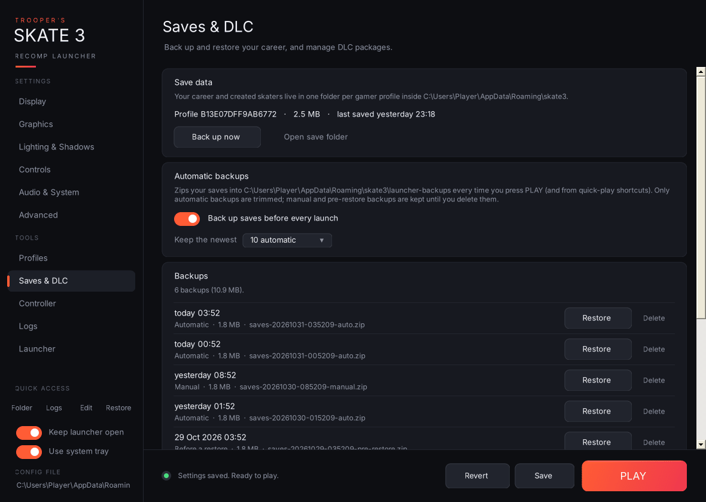

- **Save data:** lists each gamer-profile save folder (for example `B13E07DFF9AB6772`) with its size and when it was last saved. Buttons: **Back up now** and **Open save folder**. With a `saves` folder next to `skate3.exe`, this uses that folder instead (see [Portable installs](Portable-Installs)).
- **Automatic backups:** **Back up saves before every launch** is on by default. It zips every save folder into `launcher-backups` each time you press PLAY or use a quick-play shortcut. **Keep the newest** (5 / 10 / 20 / 50, default 10) applies only to *automatic* backups. Manual and pre-restore backups are never deleted for you. A failed backup never stops the game from launching.
- **Backups:** the newest 20 backups, each with its date, type (Automatic / Manual / Before a restore) and size.
  - **Restore:** refused while the game is running, and asks for confirmation. Before replacing anything it **backs up your current saves** as a "Before a restore" backup, so a restore can always be undone. It only touches the save folders inside the zip and never writes outside the save folder. Backups remember whether they came from the normal or the portable save folder, and a backup can't be restored into the other kind, because the two are laid out differently.
  - 🗑 **Delete** a backup.
  - **Open backups folder.**
- **DLC:** lists the files in `%APPDATA%\skate3\dlc` (or `dlc` next to `skate3.exe` in portable mode), the folder the game loads DLC packages from. **Add DLC files…** copies the packages you choose into it, and **Open DLC folder** opens it. Only use DLC you legally own.
