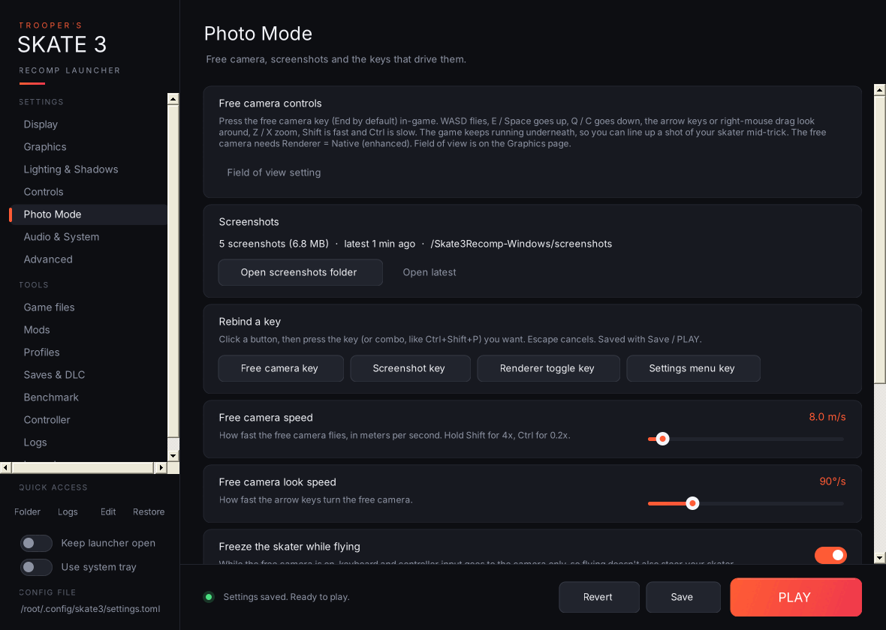

Every option writes the cvar named in brackets to `%APPDATA%\skate3\settings.toml` (or to the `settings.toml` next to `skate3.exe` in [portable mode](Portable-Installs)).

### Display
- **Fullscreen** (`fullscreen`): borderless fullscreen instead of a window.
- **Monitor** (`monitor`): which display the game opens on (Default, Monitor 1–4).
- **V-Sync** (`vsync`).
- **Variable refresh rate (G-Sync / FreeSync)** (`d3d12_allow_variable_refresh_rate_and_tearing`).
- **Frame limiter** (`d3d12_present_frame_limiter`) and **Frame limiter target** (`d3d12_present_frame_limiter_fps`, 30–360 FPS).
- **Automatic game FPS cap** (`skate3_guest_fps_cap_auto`) and **Manual game FPS cap** (`skate3_guest_fps_cap`, Off–360).
- **FPS counter** (`show_fps_counter`).

### Graphics
- **Renderer** (`skate3_native_render_scene`): Native (enhanced) or Emulated (original).
- **Render scale** (`resolution_scale`): 1x / 2x / 3x. This also writes `draw_resolution_scale_x` and `draw_resolution_scale_y`, so the three always match.
- **Anti-aliasing (MSAA)** (`skate3_native_render_scene_msaa`): Off / 2x / 4x / 8x.
- **Field of view** (`skate3_field_of_view`): 40–120°.
- **Draw distance** (`skate3_draw_distance_scale`) and **Level of detail distance** (`skate3_lod_distance_scale`): 1x–5x.
- **Ultrawide** (`skate3_ultrawide`) and **Ultrawide aspect** (`skate3_ultrawide_target_aspect`): Auto, 21:9 (2560×1080), 21:9 (3440×1440), 32:9.
- **Renderer indicator** (`skate3_native_render_mode_indicator`).

### Lighting & Shadows (Native renderer only)
Dynamic shadows, Enhanced shadow resolution, Soft shadows (PCSS), Static sun shadows and their resolution, Ambient occlusion (SSAO) and full-resolution SSAO, Bloom, Volumetric sun shafts, Directional haze, Screen-space reflections (experimental), and Packed HDR targets.

### Controls
- **Controller backend** (`input_backend`): XInput, or SDL for PlayStation, Switch and other pads.
- **Controller rumble** (`hid_rumble_enabled`).
- **Mouse & keyboard mode** (`mnk_mode`), **Capture mouse** (`mnk_capture_mouse`), **Mouse sensitivity** (`mnk_sensitivity`).
- **Settings menu button combo** (`menu_chord`): typed here, or picked and recorded on the [Controller page](Controller).
- **Skippable intro movies** (`skate3_intro_movie_skip`).

### Photo Mode

- **Free camera speed** (`skate3_native_render_scene_freecam_speed`, 0.5–100 m/s) and **Free camera look speed** (`skate3_native_render_scene_freecam_look_speed`, 10–360°/s).
- **Freeze the skater while flying** (`skate3_native_render_scene_freecam_capture_input`).
- **Free camera key** (`bind_skate3_freecam`, End), **Screenshot key** (`bind_skate3_screenshot`, F6), **Renderer toggle key** (`bind_skate3_native_render_toggle`, F5) and **Settings menu key (alternate)** (`bind_skate3_menu_alt`, F1).
- **Rebind a key:** click a button, then press the key or combo (for example Ctrl+Shift+P). Key names are written exactly the way the recomp spells them.
- **Free camera controls:** a summary of the in-game controls (WASD to fly, E/Space up, Q/C down, arrows or right-mouse drag to look, Z/X zoom, Shift fast, Ctrl slow). The free camera needs Renderer = Native.
- **Screenshots:** how many you've taken, **Open screenshots folder** (`screenshots` next to `skate3.exe`) and **Open latest**.

The quality-preset picker is hidden on this page because presets don't touch these options.

### Audio & System
- **Mute audio** (`audio_mute`) and **Audio buffer size** (`audio_device_sample_frames`).
- **Game language** (`user_language`): 12 languages.
- **Graphics API** (`gpu_backend`): Auto, Direct3D 12 or Vulkan.
- **Graphics card (Vulkan)** (`vulkan_device`): *new.* Picks which GPU the game uses with Vulkan. The list is read straight from your Vulkan driver, in the same order the game uses, and shows each card's VRAM and whether it is discrete or integrated. For example: `0: AMD Radeon RX 6800 XT (16 GB, discrete)` and `1: AMD Radeon(TM) Graphics (integrated)`. If the driver can't be queried, the list comes from the game's own log instead. "Automatic" leaves the choice to the game and writes nothing.

If `settings.toml` holds a value that isn't in a dropdown's list, the dropdown shows it as **Custom (value)** and leaves it alone.

## Features on every settings card

- **Unsaved marker:** an orange strip on the card's left edge until you save.
- **Reset to default** (↺ button next to the setting's name): appears only when the setting differs from its default. Hover it to see the default value; click it to set the setting back. Like any other change, this isn't written until you Save or press PLAY.
- **Warnings:** a yellow ⚠ line under the help text when the setting conflicts with another one, or would trigger a known recomp bug (see [Conflict warnings](Warnings-and-Known-Issues) and [Known issues](Warnings-and-Known-Issues#known-recomp-issues)).
- Scrolling the mouse wheel over a dropdown or slider scrolls the page, not the value, so you can't change something by accident.
