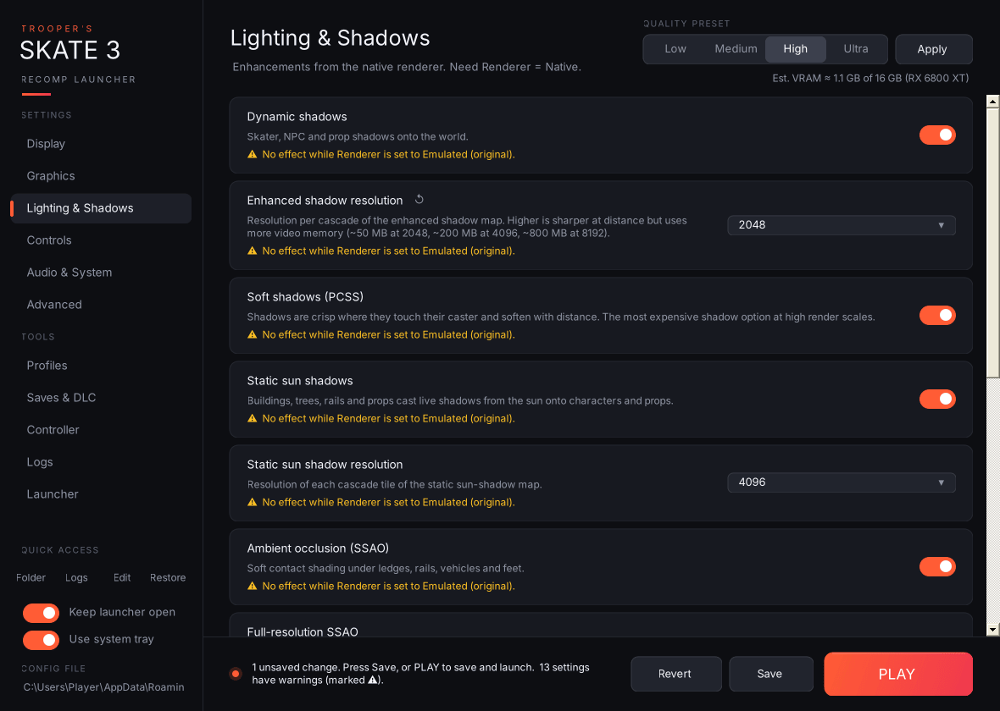

The launcher checks your settings against each other and puts a ⚠ line on the affected card:

| Situation | Warning appears on |
|---|---|
| Renderer is **Emulated** | MSAA and every Lighting & Shadows option ("No effect while Renderer is set to Emulated"), and Ultrawide (which needs Native). |
| Dynamic shadows off | Enhanced shadow resolution, Soft shadows (PCSS). |
| Static sun shadows off | Static sun shadow resolution. |
| SSAO off | Full-resolution SSAO. |
| Ultrawide off but an aspect is chosen | Ultrawide aspect. |
| V-Sync on together with VRR | V-Sync (adds latency and judder). |
| Frame limiter off but its target was changed | Frame limiter target. |
| Automatic FPS cap on and a manual cap set | Manual game FPS cap (ignored). |
| Mouse & keyboard mode off | Capture mouse, Mouse sensitivity (if changed). |
| Menu combo uses an unknown button name, or is a single button | Settings menu button combo. |
| Monitor number higher than the number of connected monitors | Monitor. |
| A Vulkan GPU is chosen but Graphics API isn't Vulkan, the index doesn't exist, or it's the integrated GPU while a discrete one exists | Graphics card (Vulkan). |
| Estimated VRAM above 90% of the GPU's memory | Render scale. |
| A key bind is empty, isn't a key name the recomp knows, or is already used (by another bind or by the recomp's own F2–F4, F8–F12, Backtick or Escape) | That key bind on the Photo Mode page. |
| Renderer is **Emulated** | Free camera key and Free camera speed (the free camera needs Native). |
| A setting matches a rule in [`known-issues.txt`](https://github.com/Trooper-code/Troopers-Skate-3-Recomp-Launcher/blob/main/known-issues.txt), for example Vulkan with Full-resolution SSAO on or a Static sun shadow resolution other than 4096 | That setting, and Graphics API. The warning names the recomp bug and the workaround. |

Warnings never block saving. They're there to tell you a setting won't do what you might expect.

## Known recomp issues

These are bugs in the Skate 3 Recomp itself, not in the launcher. They're listed here so you don't lose time on them, and removed once the recomp fixes them.

Since v3.1.1 the launcher also **warns you on the setting's card** (⚠) when your settings would trigger one of these. The rules live in [`known-issues.txt`](https://github.com/Trooper-code/Troopers-Skate-3-Recomp-Launcher/blob/main/known-issues.txt) in this repo, and the launcher downloads the latest list at most every 12 hours, so new warnings don't need a launcher update.

| Issue | Workaround |
|---|---|
| **Shadows swim, jump around or cast in the wrong place on Vulkan** when **Full-resolution SSAO** is on or **Static sun shadow resolution** is changed from 4096. Seen with recomp v2.0.2 on an AMD Radeon RX 6800 XT. | Set **Audio & System → Graphics API** to **Direct3D 12** (fixes it), or keep those two settings at their defaults (Full-resolution SSAO off, Static sun shadow resolution 4096) when using Vulkan. |

Found another one? Use **Logs → Report on GitHub…** and pick "The game (Skate 3 Recomp)".
