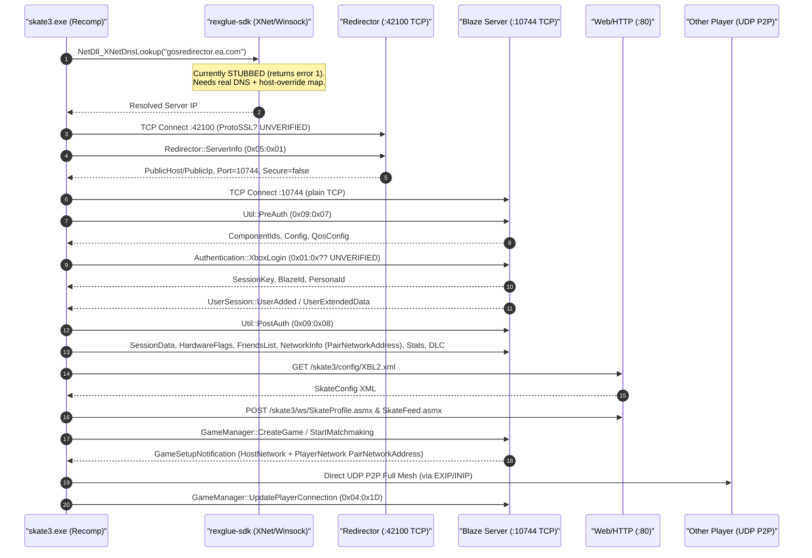

# Skate 3 Online Research: `Skateboard3Server` -> Skate 3 Recomp

## Can we get online, and what's blocking it?

- **Yes, technically feasible, but not plug-and-play today.** The Skate 3 Recomp PC port (`mchughalex/skate3recomp`) has real TCP/UDP sockets under the hood, and `Skateboard3Server` already implements the core EA Blaze login and matchmaking flow—so there is no fundamental engine barrier.
- **Blocker 1 (Recomp DNS + XNet stubs):** `rexglue-sdk`'s `NetDll_XNetDnsLookup` is stubbed to always return an error, `NetDll_XNetGetTitleXnAddr` always returns `127.0.0.1`, and `XNetXnAddrToInAddr` / `XNetInAddrToXnAddr` / `XNetQos*` are stubbed. The game cannot resolve `gosredirector.ea.com` or exchange peer addresses yet.
- **Blocker 2 (Recomp Xbox Live sign-in state):** `user_live_signed_in` defaults to `false` in `skate3recomp`, so `XamUserGetSigninState` reports local-only sign-in (`1`) instead of Xbox Live (`2`) and `XamUserGetXUID` rejects online XUID requests.
- **Blocker 3 (Server Xbox 360 auth & Web routes):** `Skateboard3Server` only accepts PS3 NP/RPCN tickets (`LoginHandler.cs`) and serves WebKit pages under `/skate3/webkit/PS3/...`. It has no Xbox 360 login path yet, and `SammyTeee/Skateboard3Server` has **zero changes** compared to `hallofmeat/Skateboard3Server`.
- **Blocker 4 (ProtoSSL on `:42100` — UNVERIFIED on 360):** On PS3, `Skateboard3Server` serves `:42100` over plain TCP while `BlazeTlsServer` (SSLv3 + RC4) sits unused in `Program.cs`. Whether the Xbox 360 TU3 binary enforces ProtoSSL cert checks on `:42100` is **UNVERIFIED** until tested with XNet DNS enabled.

---

## Plain-English Glossary

- **Blaze:** Electronic Arts' proprietary TCP/HTTP backend framework used by 2009–2015 EA games (including *Skate 3*) for login, matchmaking, stats, and friend lists.
- **Redirector (`gosredirector.ea.com:42100`):** The "phone book" server the game contacts first. It tells the game which IP, port, and encryption setting (`Secure = true/false`) to use for the main game server.
- **TDF (Tag Data Format):** Blaze's compact binary message format. Every field has a 3-byte uppercase tag (like `HOST` or `TCKT`), a 1-byte type+length header, and big-endian data.
- **ProtoSSL:** EA's custom SSL/TLS library inside DirtySDK (EA's networking SDK). On 2010-era consoles it uses **SSLv3** with RC4 ciphers (`TLS_RSA_WITH_RC4_128_MD5` / `SHA`), which modern OSes disable by default.
- **XNet / XAM:** Xbox 360's networking (`NetDll_XNet*`, `NetDll_socket`, etc.) and system/profile (`XamUser*`) APIs. In `skate3recomp`, these are implemented by the `rexglue-sdk` runtime (forked from Xenia).

---

## A. Server (`Skateboard3Server`)

### 1. Full Connection Sequence & Wire Format

#### Blaze Packet Header & TDF Serialization
- **Packet Header** ([`BlazeProtocol.cs:19-61`](https://github.com/SammyTeee/Skateboard3Server/blob/master/src/Skateboard3Server.Host/Blaze/BlazeProtocol.cs#L19-L61), [`BlazeHeader.cs:3-16`](https://github.com/SammyTeee/Skateboard3Server/blob/master/src/Skateboard3Server.Blaze/Server/BlazeHeader.cs#L3-L16)): Every Blaze TCP message starts with a **12-byte big-endian header**:
  - `Length` (`ushort`, 2 bytes): Payload size in bytes.
  - `Component` (`ushort`, 2 bytes): Service ID from `BlazeComponent` ([`BlazeEnums.cs:4-15`](https://github.com/SammyTeee/Skateboard3Server/blob/master/src/Skateboard3Server.Blaze/BlazeEnums.cs#L4-L15)), e.g. `0x0001` Authentication, `0x0004` GameManager, `0x0005` Redirector, `0x0009` Util, `0x7802` UserSession.
  - `Command` (`ushort`, 2 bytes): RPC/notification ID within that component.
  - `ErrorCode` (`ushort`, 2 bytes): `0` on success.
  - `MessageInfo` (`int`, 4 bytes): Top 4 bits (`>> 28`) are `BlazeMessageType` (`Message=0`, `Reply=1`, `Notification=2`, `ErrorReply=3`; [`BlazeEnums.cs:104-110`](https://github.com/SammyTeee/Skateboard3Server/blob/master/src/Skateboard3Server.Blaze/BlazeEnums.cs#L104-L110)); lower 20 bits (`& 0xFFFFF`) are `MessageId` to match replies to requests.
- **TDF Payload** ([`TdfHelper.cs:14-145`](https://github.com/SammyTeee/Skateboard3Server/blob/master/src/Skateboard3Server.Blaze/Serializer/TdfHelper.cs#L14-L145), [`BlazeEnums.cs:112-129`](https://github.com/SammyTeee/Skateboard3Server/blob/master/src/Skateboard3Server.Blaze/BlazeEnums.cs#L112-L129)):
  - **Tag (3 bytes):** Up to 4 uppercase ASCII letters packed into 24 bits (6 bits per char, `0x40 | (val & 0x1F)`).
  - **Type + Length (1+ bytes):** High 4 bits = `TdfType` (`Struct=0x0`, `String=0x1`, `Int8=0x2`, ..., `Array=0xA`, `Blob=0xB`, `Map=0xC`, `Union=0xD`). Low 4 bits = inline length (`0–14`), or `0xF` if a variable-length quantity (VLQ, 7 bits/byte with `0x80` continuation) follows.
  - **Value:** Big-endian scalars, null-terminated strings, or nested structs ending with `0x00`.

#### Step-by-Step Connection Sequence
1. **Redirector (`gosredirector.ea.com:42100`, TCP):**
   - `Program.cs:50-55` listens on TCP `42100` **without** `UseBlazeServerSsl` (`BlazeSslServerMiddleware` is defined at `Program.cs:107-118`, and `BlazeTlsServer.cs:35-37` implements SSLv3 with `TLS_RSA_WITH_RC4_128_MD5` / `SHA` and a comment in `BlazeTlsOptions.cs:3` for `openssl req -x509 -md5 -newkey rsa:1024`, but it is not wired into `42100` or `10744`).
   - Client sends `Redirector` (`0x05`) / `ServerInfo` (`0x01`).
   - `ServerInfoHandler.cs:22-36` replies with `PublicHost`, `PublicIp`, `Port = 10744`, `Secure = false`, `Xdns = 0`.
2. **Main Blaze Server (`<PublicHost>:10744`, plain TCP):**
   - Because the redirector returned `Secure = false`, the client connects to port `10744` over plain TCP ([`Program.cs:56-63`](https://github.com/SammyTeee/Skateboard3Server/blob/master/src/Skateboard3Server.Host/Program.cs#L56-L63)).
   - **PreAuth:** `Util` (`0x09`) / `PreAuth` (`0x07`) -> [`PreAuthHandler.cs:21-90`](https://github.com/SammyTeee/Skateboard3Server/blob/master/src/Skateboard3Server.Blaze/Handlers/Util/PreAuthHandler.cs#L21-L90) returns supported `ComponentIds`, `pingPeriodInMs = 15000`, `voipHeadsetUpdateRate = 1000`, and `QosConfig` (`BandwidthServer` default port `17502` + `PingServers` from `BlazeConfig.QosHosts`).
   - **Login:** `Authentication` (`0x01`) / `Login` (`0xC8`) -> [`LoginHandler.cs:48-190`](https://github.com/SammyTeee/Skateboard3Server/blob/master/src/Skateboard3Server.Blaze/Handlers/Authentication/LoginHandler.cs#L48-L190) parses and optionally validates a PS3 NP/RPCN ticket, creates/loads the `User` and `Persona`, stores `UserSessionData`, and returns `LoginResponse` (`SessionKey`, `BlazeId`, `PersonaId`, `ExternalIdType.Ps3`).
   - **Server Notifications:** Server pushes `UserAddedNotification` (`UserSession` `0x7802` / `0x02`) and `UserExtendedDataNotification` (`UserSession` `0x7802` / `0x01`) ([`LoginHandler.cs:153-189`](https://github.com/SammyTeee/Skateboard3Server/blob/master/src/Skateboard3Server.Blaze/Handlers/Authentication/LoginHandler.cs#L153-L189), [`hallofmeat/notes`](https://github.com/hallofmeat/notes/blob/master/skate3/blaze-flows/login_existing_account.md)).
   - **PostAuth:** `Util` (`0x09`) / `PostAuth` (`0x08`) -> [`PostAuthHandler.cs:22-47`](https://github.com/SammyTeee/Skateboard3Server/blob/master/src/Skateboard3Server.Blaze/Handlers/Util/PostAuthHandler.cs#L22-L47) returns telemetry (`PublicIp:9946`) and tick server (`PublicIp:8999`) info (both commented out in `Program.cs:69-82`).
   - **Post-Login Setup Sequence:**
     - `Authentication` (`0x01`) / `SessionData` (`0xE6`) -> `SessionDataHandler.cs`
     - `UserSession` (`0x7802`) / `HardwareFlags` (`0x08`) -> `HardwareFlagsHandler.cs`
     - `Social` (`0x19`) / `FriendsList` (`0x06`) -> `FriendsListHandler.cs`
     - `UserSession` (`0x7802`) / `NetworkInfo` (`0x14`) -> [`NetworkInfoHandler.cs:22-34`](https://github.com/SammyTeee/Skateboard3Server/blob/master/src/Skateboard3Server.Blaze/Handlers/UserSession/NetworkInfoHandler.cs#L22-L34)
     - `SkateStats` (`0x0C`) / `UpdateStats` (`0x02`) -> `SkateStatsHandler.cs`
     - `Authentication` (`0x01`) / `Dlc` (`0x20`) -> `DlcHandler.cs` (looped per DLC)
     - `Teams` (`0x0B`) / `TeamMembership` (`0xA8C`), `TeamInvitations` (`0x640`), `TeamMembers` (`0x7D0`)
     - Periodic `Util` (`0x09`) / `Ping` (`0x02`) -> `PingHandler.cs` and `ClientMetrics` (`0x16`) -> `ClientMetricsHandler.cs`.
3. **HTTP Services (`downloads.skate.online.ea.com:80`, HTTP/1.1):**
   - Configured via `Kestrel.Endpoints.Web.Url = "http://*:80"` ([`appsettings.json:10-16`](https://github.com/SammyTeee/Skateboard3Server/blob/master/src/Skateboard3Server.Host/appsettings.json#L10-L16)).
   - Config XML: `GET /skate3/config/PS3.xml` and `GET /skate3/config/XBL2.xml` ([`ConfigController.cs:10-116`](https://github.com/SammyTeee/Skateboard3Server/blob/master/src/Skateboard3Server.Web/Controllers/ConfigController.cs#L10-L116)).
   - ASMX Web Services (POX XML): `/skate3/ws/SkateFeed.asmx/PlayerSignedIntoEANation` (`SkateFeedServiceController.cs:7-11`) and `/skate3/ws/SkateProfile.asmx/*` (`SkateProfileServiceController.cs:12-97`).
   - WebKit UI pages: `/skate3/webkit/PS3/English/i/{Sessions,SkateFeed,Leaderboards,Teams,Users,Test}/...` (note: currently hardcoded to `PS3` in all controller `[Route]` attributes).
   - Hostnames redirected in [`DEVELOPMENT.md:21`](https://github.com/SammyTeee/Skateboard3Server/blob/master/DEVELOPMENT.md#L21): `gosredirector.ea.com`, `downloads.skate.online.ea.com`, `gosredirector.stest.ea.com`, `downloads.skate.test.online.ea.com`.

### 2. Original (`hallofmeat/Skateboard3Server`) vs. Fork (`SammyTeee/Skateboard3Server`)

- **Result:** `SammyTeee/Skateboard3Server` (`master`, commit `0e7858b0f7d3e1dde37e608a6d89e36ce1dc44c8`, "Update LICENSE") is an **exact, unmodified mirror** of `hallofmeat/Skateboard3Server` (`master`, `0e7858b0f7d3e1dde37e608a6d89e36ce1dc44c8`).
- `git diff --stat upstream/master HEAD` shows **0 files changed**, and `git ls-remote` confirms `SammyTeee/Skateboard3Server` has only the `master` branch. Any Xbox 360 work will need to be built from scratch on top of `Skateboard3Server` (or contributed upstream).

### 3. Xbox 360 Login vs. PS3 Ticket Login

- **What `Skateboard3Server` has today:**
  - `LoginHandler.cs` (`Authentication` `0x01`, Command `0xC8`) only accepts `LoginRequest` with `MAIL` (string) and `TCKT` (`byte[]` PS3 NP/RPCN ticket) ([`LoginRequest.cs:10-19`](https://github.com/SammyTeee/Skateboard3Server/blob/master/src/Skateboard3Server.Blaze/Handlers/Authentication/Messages/LoginRequest.cs#L10-L19)).
  - It hardcodes `"ps3"` in `ExternalBlob` (`LoginHandler.cs:73`) and `ExternalIdType.Ps3` (`LoginHandler.cs:145`), though `BlazeEnums.cs:134,150` (`FirstPartyIdType.Xbox = 0x1`, `ExternalIdType.Xbox = 0x1`), `Persona.cs:40` (`PersonaExternalIdType.Xbox`), and `ConfigController.cs:114` (`XBL2.xml`) already have Xbox enum/config placeholders.
  - Note the comment in [`BlazeEnums.cs:20`](https://github.com/SammyTeee/Skateboard3Server/blob/master/src/Skateboard3Server.Blaze/BlazeEnums.cs#L20): `Login = 0xC8, //TODO: might be just login for ps3?`.
- **What an Xbox 360 client sends:**
  - In EA's 2009–2010 Blaze SDK, Xbox 360 clients typically use a separate `Authentication` command (commonly referred to as `xboxLogin` / `xblLogin`, often carrying Gamertag + XUID + XBL token/ticket), **however the exact command ID and TDF field tags used by Skate 3's Xbox 360 TU3 binary are `UNVERIFIED`** because no Xbox 360 Skate 3 packet capture exists in `hallofmeat/Skateboard3Server` or `hallofmeat/notes`.
  - **How to capture it:** Once `skate3recomp` has `NetDll_XNetDnsLookup` working and connects to `Skateboard3Server:10744`, `BlazeProtocol` (`Program.cs:58-63`) already logs the full hex dump of every incoming Blaze packet (`HexLoggingFormatter`), immediately revealing the exact `Command` ID and TDF tags.
- **What the server needs for a 360 login path:**
  1. A new `BlazeRequest` / `IRequestHandler` for the Xbox 360 login command (with `Flags.EnableTicketValidation` / dev mode allowing trust of client-supplied `XUID` + `Gamertag` without Microsoft XSTS/PartnerNet verification).
  2. Creating/looking up `Persona` with `PersonaExternalIdType.Xbox`, `ExternalId = xuid`, `Username = gamertag`, and returning `ExternalIdType.Xbox` in `LoginResponse`.
  3. **Upstream PR?** Yes — `Skateboard3Server` already has `Xbox` enums and `XBL2.xml`, so a clean Xbox 360 login handler (gated behind `EnableTicketValidation = false` or an `AllowInsecureXboxLogin` flag) is a natural upstream PR to `Skateboard3Server`, though `hallofmeat/Skateboard3Server` is archived so any PR would target an active fork or our own fork.

### 4. Matchmaking, Peer Addresses, and P2P Gameplay

- **Address exchange:**
  - On login, the client sends `NetworkInfoRequest` (`UserSession` `0x14`) with a `PairNetworkAddress` (`EXIP` = external IP/port, `INIP` = internal IP/port). `NetworkInfoHandler.cs:29` saves it to `currentSession.NetworkAddress`.
  - When a player creates a game (`CreateGameHandler.cs:47,59,84,110-124`) or joins via matchmaking (`StartMatchmakingHandler.cs:164-331`), the server:
    - Sets `NetworkTopology = NetworkTopology.PeerToPeerFullMesh` and `VoipTopology = VoipTopology.PeerToPeer`.
    - Broadcasts `UserAddedNotification` + `UserExtendedDataNotification` (including `PairNetworkAddress` and hardcoded `QosNetworkData { DownstreamBitsPerSecond = 100000, NatType = NatType.Open, UpstreamBitsPerSecond = 100000 }`).
    - Sends `GameSetupNotification` (`GameSetupNotification.cs:26-114`) with `HostNetwork`, `Players[i].PlayerNetwork` (`PairNetworkAddress`), `PlatformHost`, and `TopologyHost`.
  - `QosHosts` in `appsettings.json:25` (`[]` by default) populates `PreAuthResponse.QosConfig` (`BandwidthServer` default port `17502` + `PingServers`; `PreAuthHandler.cs:23-51`).
- **Is gameplay P2P?** Yes (`PeerToPeerFullMesh`). After `GameSetupNotification`, clients connect directly to each other over UDP using the `EXIP`/`INIP` addresses and report connection state back via `UpdatePlayerConnection` (`GameManager` `0x1D`, `UpdatePlayerConnectionHandler.cs:19-48`).
- **Xbox 360 gap:** `GameSetupNotification.cs:109-113` has `XNNC` and `XSES` (`byte[]?` for Xbox Live session key/nonce), currently hardcoded to `null` in `CreateGameHandler.cs` / `StartMatchmakingHandler.cs`.

---

## B. Recomp (`mchughalex/skate3recomp`)

### 1. Console Build Origin
- **Confirmed Xbox 360:**
  - `README.md:7`: *"An unofficial native recompilation of the Xbox 360 version of Skate 3"*.
  - `manifests/skate3.toml.in:6`: `file_path = "@SKATE3_GAME_DATA_ROOT_CONFIG@/default.xex"`.
  - `src/skate3_title_update_installer.cpp:57`: `// (Skate 3 title 454108E6, base 3.0.0.0 -> 3.0.3.0, media ID 5C087C2C).` (Title Update 3).
  - Runtime SDK: `third_party/rexglue-sdk` (`mchughalex/rexglue-skate3`, branch `skate3-sdk-clean`), which implements Xbox 360 `xam.xex` / `xboxkrnl.exe` APIs.

### 2. Networking Layer (`rexglue-sdk`)
- **BSD/Winsock sockets ARE implemented:** In `third_party/rexglue-sdk/src/kernel/xam/xam_net.cpp:578-920` and `src/system/xsocket.cpp:53-241` (`socket_win.cpp` on Windows), `NetDll_socket`, `NetDll_closesocket`, `NetDll_connect`, `NetDll_bind`, `NetDll_listen`, `NetDll_accept`, `NetDll_select`, `NetDll_send`, `NetDll_recv`, `NetDll_sendto`, `NetDll_recvfrom`, `NetDll_setsockopt`, `NetDll_ioctlsocket`, `NetDll_inet_addr`, and `WSAStartup`/`WSACreateEvent` map to real Winsock2 (`WinSock2.h`).
- **XNet & QoS are STUBBED:**
  - `NetDll_XNetGetTitleXnAddr_entry` (`xam_net.cpp:435-457`): Returns `INADDR_LOOPBACK` (`127.0.0.1`), `inaOnline = 0`, `wPortOnline = 0`, `abEnet = 0xCC...`, status `XNET_GET_XNADDR_STATIC`.
  - `NetDll_XNetXnAddrToInAddr_entry` (`xam_net.cpp:478-481`) & `NetDll_XNetInAddrToXnAddr_entry` (`485-488`): Both return `1` (error).
  - `NetDll_XNetQosServiceLookup_entry` (`xam_net.cpp:533-547`): Returns `count = 0`. `NetDll_XNetQosListen_entry` (`557-560`): Returns `X_ERROR_FUNCTION_FAILED`.
  - `XSession*` in `src/kernel/xam/apps/xgi_app.cpp:156-446`: Logs debug messages / stubbed.

### 3. Hostname Resolution (`gosredirector.ea.com`)
- **Currently impossible without a recomp change:** `NetDll_XNetDnsLookup_entry` (`xam_net.cpp:509-523`) has `// TODO(gibbed): actually implement this` and unconditionally sets `dns->status = 1` (error) without calling `getaddrinfo` or Winsock DNS.
- Because `XNetDnsLookup` never calls Windows DNS, **neither a `hosts` file edit nor a Winsock `getaddrinfo` hook DLL can redirect `gosredirector.ea.com` today.**
- **Existing config:** `config/skate3.example.toml` has **no** host-redirect or IP-switch cvar (unlike RPCS3's IP/Host Switches).

### 4. ProtoSSL on `:42100`
- **Status: `UNVERIFIED` on the Xbox 360 TU3 binary.**
- EA DirtySDK titles of this era commonly use ProtoSSL (SSLv3 + `TLS_RSA_WITH_RC4_128_MD5`/`SHA`) on `gosredirector.ea.com:42100`, and `Skateboard3Server` already includes `BlazeSslServerMiddleware` / `BlazeTlsServer.cs` for SSLv3, though it is disabled in `Program.cs:50-55` for PS3.
- If the 360 build *does* use ProtoSSL on `:42100` and rejects self-signed certs:
  - **Option 1 (Server-side):** Enable `UseBlazeServerSsl` on `:42100` with a cert matching what ProtoSSL accepts (if DirtySDK's classic MD5/RSA signature bug or a non-verifying build applies, or if the client only checks CN).
  - **Option 2 (Recomp-side code patch):** Locate the DirtySDK ProtoSSL certificate-verification function in the recompiled PPC code (via `config/skate3_tu_functions.toml` + `REX_HOOK`) and bypass/accept the server cert in C++—no modified game files needed.

### 5. Xbox Live Sign-In State
- `XamUserGetSigninState_entry` (`xam_user.cpp:77-86`) calls `UserProfile::signin_state()` (`user_profile.cpp:153-158`):
  - Returns `0` if `user_profile_signed_in == false`
  - Returns `1` (local only) if `user_live_signed_in == false`
  - Returns `2` (signed into Xbox Live) if `user_live_signed_in == true`
- In `config/skate3.example.toml:84` and `user_profile.cpp:30`, `user_live_signed_in` defaults to `false`. Additionally, `XamUserGetXUID_entry` (`xam_user.cpp:46-75`) checks `type_mask & (2 | 4)` for online XUIDs, which fails with `X_E_NO_SUCH_USER` when `user_live_signed_in == false`.
- **Good news:** `skate3recomp` already has `user_live_signed_in`, `user_profile_name`, and `user_profile_xuid` cvars, so toggling `user_live_signed_in = true` in `settings.toml` (from the launcher!) unlocks Live sign-in state without recomp changes.

---

## C. Connection Flow Diagram

---

## D. Launcher Integration Options (Windows 11, Portable Single `.exe`)

### 1. Server Picker
- Store in `launcher.ini` via `LauncherPrefs` (`AGENTS.md:85`): e.g. `online_mode` (`off` / `community` / `custom` / `local`), `online_custom_host` (IP/hostname), and `online_live_signin` (bool, which writes `user_live_signed_in = true` into `settings.toml` when enabled).

### 2. Hostname Redirect Options (Ranked)
| Option | Effort | Reliability | Admin? | Notes |
|---|---|---|---|---|
| **1. Recomp-side `host_redirects` cvar / `XNetDnsLookup` (Recommended)** | **S–M** (in `skate3recomp`) | **High** | **No** | Implement `NetDll_XNetDnsLookup` in `rexglue-sdk` + a TOML/CLI host-override map (like RPCS3's IP/Host Switches). Launcher just writes `settings.toml` or passes CLI args. |
| **2. Winsock / `getaddrinfo` hook DLL** | **M–L** | **Medium** | **No** | Fails today because `XNetDnsLookup` never calls Winsock `getaddrinfo`. Also breaks the launcher's single-exe rule (`AGENTS.md:7` — no extra DLLs). |
| **3. Windows `hosts` file edit** | **S** | **Low** | **Yes (UAC)** | Fails today (no DNS lookup). Requires admin, affects the whole PC, and risks leaving stale entries if the game crashes. |

**Recommendation:** Option 1 (`skate3recomp` / `rexglue-sdk` host-redirect cvar + `XNetDnsLookup`). It needs no admin rights, stays 100% portable, and works on Windows, Linux, and macOS alike.

### 3. Optional "Host a Local Server" Button
- `Skateboard3Server` is .NET 6 (`net6.0`, SQLite + Kestrel). It can be published as a self-contained Windows x64 executable (`dotnet publish -c Release -r win-x64 --self-contained true -p:PublishSingleFile=true`) and downloaded on demand into a `server\` subfolder next to the launcher (keeping the launcher itself a small single `.exe`), then launched/stopped as a child process (`Process.Start`) with `appsettings.json` generated from the user's LAN/public IP.
- **Port 80 on Windows 11:** Unlike Linux, Windows does **not** require admin rights for Kestrel (socket transport) to bind to TCP port `80` *unless* `http.sys` (e.g., IIS, Print/WebClient, WinRM) has already reserved port `80`, in which case binding fails and either needs that service stopped, a `netsh http` / `portproxy` rule (admin), or running HTTP on `8080` with client-side port/URL rewriting.

### 4. Firewall & Port Requirements
- **Hosting a server (`Skateboard3Server`):**
  - `TCP 42100` (Redirector)
  - `TCP 10744` (Main Blaze server)
  - `TCP 80` (HTTP config, profiles, WebKit)
  - *(Optional if implemented later)* `TCP 9946` (Telemetry), `TCP 8999` (Tick), `UDP 17502` (QoS)
- **Playing as a client (P2P):** Outbound TCP `42100`, `10744`, `80`; inbound/outbound UDP on the game's P2P ports (Windows Defender Firewall prompt on first launch; UPnP or router port-forwarding if hosting P2P matches behind Strict NAT).
- **Plain-English UI text:**
  > *"When Windows asks if `skate3.exe` can access private and public networks, click **Allow**. To host matches for friends outside your home network, you may also need UPnP enabled on your router."*

---

## E. Blockers Summary Table

| Blocker | Lives in | Effort | Proposed Fix |
|---|---|---|---|
| `NetDll_XNetDnsLookup` is stubbed (always errors) | Recomp (`rexglue-sdk`) | **S** | Implement `getaddrinfo` DNS lookup + host-override map cvar (`online_host_overrides`). |
| `XNetGetTitleXnAddr` returns `127.0.0.1`; `XNetXnAddrToInAddr` / `InAddrToXnAddr` stubbed | Recomp (`rexglue-sdk`) | **M** | Return real local/LAN IP in `XNetGetTitleXnAddr` and map `XNADDR` <-> `IN_ADDR` for P2P. |
| `user_live_signed_in` defaults to `false` | Recomp + Launcher | **S** | Launcher sets `user_live_signed_in = true` in `settings.toml` when online mode is enabled. |
| No Xbox 360 login handler in Blaze server | Server (`Skateboard3Server`) | **M** | Capture 360 login packet via `BlazeProtocol` hex log; add Xbox login handler (`ExternalIdType.Xbox`). |
| ProtoSSL on `:42100` (if enforced by 360 TU3) | Server or Recomp | **M** | Either enable `BlazeSslServerMiddleware` on `:42100` or hook/bypass cert check in `skate3recomp`. |
| WebKit routes hardcoded to `/skate3/webkit/PS3/...` | Server (`Skateboard3Server`) | **S** | Add `/skate3/webkit/XBL2/...` route aliases (verify exact path from 404 logs). |
| `XNNC` / `XSES` session blobs & `XNetQos*` for P2P | Server + Recomp | **L** | Test if 360 Skate 3 accepts `null`/dummy `XNNC`/`XSES` or needs `XNetQos*` + `XSession*` wiring. |
| Server picker, `settings.toml` sync, optional local server runner | Launcher | **M** | Add "Online" tool card in launcher (`launcher.ini` + `settings.toml` + optional server download). |
